# Guía de estudio: las 4 técnicas de explicabilidad sobre moondream2 y la estadística que las sostiene

**Para:** Walter Sanhueza · **Memoria:** *Evaluación de modelos de lenguaje visual de escala reducida en tareas de conteo visual y razonamiento espacial* (v5)
**Qué es esto:** material de estudio, no es parte de la memoria ni de la presentación. Sirve para entender de verdad qué hace cada técnica, con qué matemática, con qué código, y para poder volver a los papers originales con una base firme.

---

## Cómo leer esta guía

Cada técnica se explica en **capas**, de lo más amable a lo más denso. Puedes parar en la capa que necesites y volver cuando haga falta.

| Marca | Capa | Qué encontrarás |
|---|---|---|
| 🧒 | **Versión niño de 5 años** | Una analogía. Si entiendes esto, ya sabes *qué pregunta* responde la técnica. |
| 🔧 | **Cómo funciona, paso a paso** | Qué entra, qué sale, qué se calcula, sin fórmulas todavía. |
| 📐 | **Matemática** | Las ecuaciones (con la numeración de tu memoria) y de dónde salen. |
| 💻 | **Código** | Fragmentos reales: del código fuente de moondream2 y de tus notebooks, comentados. |
| 📊 | **Qué salió en tu experimento** | Las cifras de la memoria, reproducidas desde tus CSV. |
| ⚠️ | **Límites** | Qué NO puede decir la técnica. Esto es lo que más pregunta un profesor. |
| 📚 | **Papers** | Qué leer, en qué orden, y qué buscar en cada uno. |

**Sobre las ecuaciones.** Están escritas en LaTeX (`$...$`). Se ven bien en GitHub, en VS Code (con la vista previa de Markdown), en Obsidian y en Typora. Si abres el `.md` en un editor de texto plano verás los símbolos crudos; para eso va también la versión `.html`, que se abre en cualquier navegador.

**Sobre lo que es mío y lo que es de la memoria.** Todo lo que lleva "Ec. X.Y" está en tu memoria v5. Donde hay una deducción o un ejemplo numérico que **no** está en la memoria (los marco como *ejemplo didáctico* o *deducción propia*), lo digo explícitamente. Las cifras de resultados las recalculé desde tus CSV y coinciden con la memoria (ver Apéndice A).

---

## Índice

1. [El mapa general: qué pregunta responde cada técnica](#1-el-mapa-general-qué-pregunta-responde-cada-técnica)
2. [Ladrillos previos (lo mínimo para entender todo lo demás)](#2-ladrillos-previos)
3. [El modelo: moondream2 por dentro](#3-el-modelo-moondream2-por-dentro)
4. [Técnica 1 · Oclusión](#4-técnica-1--oclusión)
5. [Técnica 2 · Grounding con `point()`](#5-técnica-2--grounding-con-point)
6. [Técnica 3 · Attention rollout](#6-técnica-3--attention-rollout)
7. [Técnica 4 · Grad-CAM y gradiente × entrada](#7-técnica-4--grad-cam-y-gradiente--entrada)
8. [La base estadística](#8-la-base-estadística)
9. [Cómo se juntan las cuatro: qué prueba cada una y qué no](#9-cómo-se-juntan-las-cuatro)
10. [Preguntas que te pueden hacer (con respuesta)](#10-preguntas-que-te-pueden-hacer)
11. [Mapa de papers y ruta de lectura](#11-mapa-de-papers-y-ruta-de-lectura)
12. [Glosario](#12-glosario)
13. [Apéndice A: cómo reproducir las cifras](#apéndice-a-cómo-reproducir-las-cifras)

---

## 1. El mapa general: qué pregunta responde cada técnica

La pregunta de fondo de tu experimento (memoria §3.4) es:

> **¿moondream2 *cuenta* las figuras, o *estima* con una heurística?**

Para responderla no basta una técnica, porque cada una mira algo distinto. Piensa en un alumno que dice "hay 4 autos":

- Puedes **taparle un auto y preguntar de nuevo** (oclusión): ¿cambió la respuesta? → *¿usa de verdad ese auto?*
- Puedes **pedirle que los señale con el dedo** (grounding): ¿los encuentra? → *¿los ve?*
- Puedes **abrirle la cabeza y mirar adónde atiende** (rollout): ¿qué partes de la imagen "se miran" entre sí? → *¿qué procesa la parte visual?*
- Puedes **medir cuánto influye cada parte de la imagen en el número que dijo** (Grad-CAM, gradiente×entrada): → *¿qué parte empujó a decir "4"?*

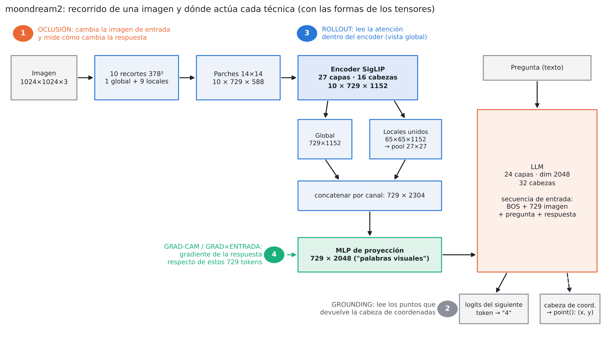

*Figura 1 (propia). Recorrido de una imagen por moondream2 y punto donde actúa cada técnica. Los tamaños son los reales del código. Compárala con la Figura 9 de la memoria (más abajo, §3.1).*

### Las cuatro técnicas en una tabla

| | **Oclusión** | **Grounding (`point()`)** | **Attention rollout** | **Grad-CAM / grad×entrada** |
|---|---|---|---|---|
| **Familia** | Conducta (caja negra), *intervención* | Conducta (caja negra), *habilidad auxiliar* | Interna, *observación* | Interna, *atribución* |
| **Qué toma como entrada** | La imagen (modificada) + la pregunta | La imagen + el nombre del objeto | Solo la imagen (el encoder no ve la pregunta) | Imagen + pregunta + el número que el modelo eligió |
| **Qué mira del modelo** | Solo la respuesta final | Solo las coordenadas finales | Las matrices de atención del encoder visual | Los gradientes sobre los 729 tokens de imagen que entran al LLM |
| **Qué produce** | "La respuesta cambió / no cambió" | Una lista de puntos (x, y) | Un mapa de 27×27 (distribución, suma 1) | Un mapa de 27×27 (Grad-CAM ≥ 0; grad×entrada con signo) |
| **¿Es causal?** | **Sí** (cambia la imagen y mide el efecto) | No directamente | **No** | **No** (es una sensibilidad local) |
| **Pregunta que responde** | ¿La respuesta *depende* de esas figuras? | ¿El modelo *localiza* las figuras? | ¿Qué *procesa* el encoder? | ¿Qué partes *empujan* la respuesta? |
| **Ecuaciones (memoria)** | 2.23, 3.6, 3.7 | 3.8–3.10 | 2.18–2.20 | 2.21, 2.22, 3.11 |

> **La jerarquía de evidencia que conviene tener en la cabeza** (la desarrollo en §9): una **intervención** (oclusión) pesa más que una **observación** (rollout). Una *habilidad* (grounding) pesa más que un *mapa de calor*. Y un mapa de calor que no se contrasta con una intervención no demuestra nada sobre qué usa el modelo. Eso es justo lo que concluye tu memoria (§4.7.5).

---

## 2. Ladrillos previos

Si ya dominas Transformers, salta a la §3. Si no, esto es lo mínimo que usan las cuatro técnicas.

### 2.1 Token, embedding, y "palabra visual"

🧒 *Un modelo de lenguaje no lee letras ni mira píxeles: lee "fichas". Cada ficha es una lista larga de números que describe lo que representa.*

- **Token:** una unidad de entrada. En texto, un pedazo de palabra. En imagen, un cuadradito (**parche**).
- **Embedding:** el vector (lista de números) que representa un token. En moondream2, un token de imagen que entra al LLM es un vector de **2048 números**.
- Una imagen se convierte en una **secuencia de tokens**, y el LLM la procesa igual que a una frase. Por eso en esta guía "token de imagen" y "palabra visual" son lo mismo.

### 2.2 Atención (self-attention)

🧒 *En una sala hay muchos niños. Cada uno hace una pregunta ("¿alguien tiene algo rojo?"), y cada niño tiene un cartel que dice qué sabe. Cada uno atiende más a los que tienen el cartel que mejor responde su pregunta, y se queda con un resumen de lo que dijeron.*

📐 Cada token $i$ produce una **consulta** $\mathbf{q}_i$, una **clave** $\mathbf{k}_i$ y un **valor** $\mathbf{v}_i$ (tres proyecciones lineales del mismo vector). La atención de $i$ hacia $j$ es

$$A_{ij} = \mathrm{softmax}_j\!\left(\frac{\mathbf{q}_i\cdot\mathbf{k}_j}{\sqrt{d_h}}\right),\qquad \text{salida}_i=\sum_j A_{ij}\,\mathbf{v}_j$$

(Ec. 2.18 en forma matricial: $\mathbf{A}=\mathrm{softmax}(\mathbf{Q}\mathbf{K}^\top/\sqrt{d_h})$.)

- El **softmax** por filas hace que cada fila sume 1: es una distribución de "cuánto atiende $i$ a cada $j$".
- Una **cabeza** es una copia independiente de este mecanismo con sus propias proyecciones. Se usan varias (16 en el encoder de moondream2, 32 en su LLM) y se concatenan.
- **Atención bidireccional** (todos ven a todos, como en el encoder visual) vs **causal** (cada token solo ve los anteriores, como en el LLM al escribir la respuesta). Esto importa en §3.5 y §6.

Paper de origen: Vaswani et al. (2017), *Attention is all you need* (arXiv:1706.03762).

### 2.3 Conexión residual

Un bloque de Transformer no reemplaza el vector, le **suma** un cambio: $\mathbf{x}\leftarrow\mathbf{x}+\mathrm{Atención}(\mathbf{x})$, y luego $\mathbf{x}\leftarrow\mathbf{x}+\mathrm{MLP}(\mathbf{x})$. Esa suma ("atajo") es la razón de que el rollout (§6) agregue una identidad $\mathbf{I}$: cada token **conserva** su propia información además de lo que recoge de otros.

### 2.4 Logit, softmax y "el primer token de la respuesta"

El LLM produce, para cada posición, un vector de **logits**: un puntaje por cada palabra posible del vocabulario (51.200 en moondream2). El **softmax** de esos puntajes da probabilidades. Con temperatura 0 el modelo elige el token de mayor logit (*argmax*).

Cuando le pides "How many circles…? Respond with only the integer number.", la respuesta es un número como "4". Ese "4" es **un token**, y su logit (antes del softmax) es el objetivo del Grad-CAM: $s_{y^*}$ en la Ec. 2.21.

### 2.5 Gradiente y retropropagación

🧒 *Imagina que el modelo es una máquina de hacer salsa con miles de perillas. Giras una perilla un poquito y miras cuánto cambia el sabor final. Eso es el gradiente: "cuánto cambia la salida si muevo este número un poquito".*

📐 Para una función $s(\mathbf{E})$, el gradiente $\partial s/\partial E_{tc}$ es la **pendiente** de $s$ respecto del número $E_{tc}$. La **retropropagación** (*backward*) calcula todos esos gradientes de golpe aplicando la regla de la cadena de la salida hacia atrás. En PyTorch: `s.backward()` y luego `E.grad`.

Aproximación de primer orden (la base de gradiente×entrada, §7): $s(\mathbf{E}+\Delta)\approx s(\mathbf{E})+\sum_{t,c}\frac{\partial s}{\partial E_{tc}}\Delta_{tc}$.

### 2.6 Intervención vs observación

Esta distinción atraviesa toda la guía:

- **Observar** es mirar el interior mientras el modelo trabaja normal (rollout, gradientes). Te dice *qué pasó*, no *qué importó*.
- **Intervenir** es cambiar algo y ver qué pasa (oclusión). Te dice *qué causa qué*.

---

## 3. El modelo: moondream2 por dentro

> **Fuente.** moondream2 no tiene paper. Lo que sigue sale del **código fuente** (repositorio `vikhyat/moondream`, commit `44146f1`, que corresponde a la revisión `2025-06-21` de tus notebooks) y de la ficha del modelo (Korrapati, 2025). Todo número de esta sección (dimensiones, capas, tamaños) lo leí en `config.py`, `vision.py`, `text.py`, `moondream.py` e `image_crops.py`. Tu notebook `anatomia_moondream2.ipynb` recorre esto paso a paso con asserts; es la mejor forma de verlo ejecutarse.

### 3.1 La Figura 9 de tu memoria

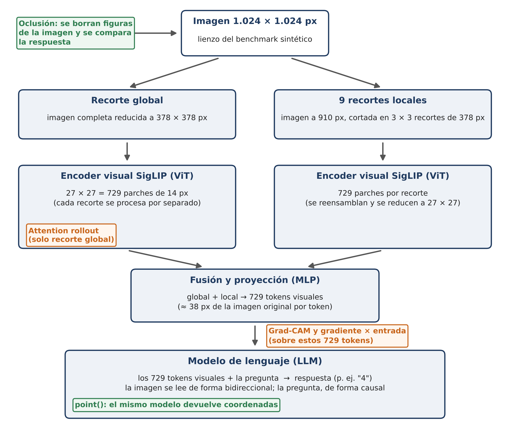

*Figura 9 (memoria §3.4): recorrido de una imagen dentro de moondream2 y punto donde actúa cada técnica.*

Usa la Figura 1 de esta guía (arriba) junto con esta: la mía agrega las **formas de los tensores** y separa los pasos de fusión.

### 3.2 Paso 1 · De una imagen a 10 recortes

🧒 *El modelo tiene "ojos" que solo pueden mirar fotos chicas (378×378). Para no perder detalle, mira la foto entera achicada, y además mira 9 pedazos de la foto agrandada.*

🔧 Para tus imágenes de 1024×1024 (`image_crops.py`, `overlap_crop_image`):

1. **Recorte global:** toda la imagen redimensionada a 378×378.
2. **Recortes locales:** la imagen se agranda a **910×910** y se corta en **3×3 = 9 ventanas** de 378×378. Las ventanas avanzan de a **266 px** (378 − 2·56), así que se **solapan 112 px**. Ese margen (`overlap_margin=4` parches = 56 px a cada lado) evita cortar figuras justo en el borde.
3. Total: **10 recortes** de 378×378×3.

De dónde sale el 3×3 (código real, `select_tiling`): se calcula cuántas ventanas de 266 px cubren los 912 px útiles (1024 − 112): `ceil(912/266) = 4` por lado, o sea 16 ventanas, pero el máximo permitido es `max_crops=12`; entonces escala por `sqrt(12/16)=0,866` y toma `floor(4·0,866) = 3`. Resultado: **(3, 3)**.

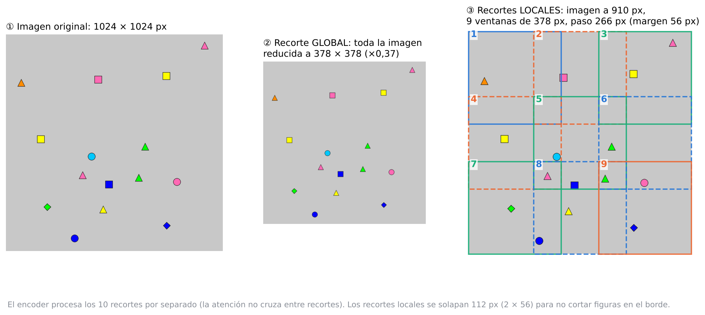

*Figura 2 (propia, imagen real q002 de tu conjunto). El recorte global ve todo con poco detalle (×0,37); los locales ven pedazos con más detalle (×0,89).*

### 3.3 Paso 2 · Parches y encoder visual (SigLIP)

🔧 Cada recorte de 378×378 se corta en **27×27 = 729 parches de 14×14 px**, y cada parche se aplana a $14\cdot14\cdot3 = 588$ números. Luego:

1. `patch_emb`: una matriz aprendida de 588×1152 convierte cada parche en un vector de **1152** números.
2. `+ pos_emb`: se suma un vector aprendido por posición (para que el modelo sepa *dónde* está cada parche).
3. **27 bloques** (capas). Cada bloque = **atención** (los 729 parches de ese recorte se mezclan entre sí, 16 cabezas) + **MLP** (cada parche se transforma por separado).
4. Un `LayerNorm` final.

Este encoder es **SigLIP so400m** (Zhai et al., 2023, ICCV; arXiv:2303.15343), un Vision Transformer (Dosovitskiy et al., 2021; arXiv:2010.11929). Tres propiedades que importan para las técnicas:

- **No recibe la pregunta.** El encoder ve la imagen y nada más. Por eso el rollout (§6) es el mismo para cualquier pregunta sobre esa imagen.
- **Cada recorte se procesa por separado.** La atención no cruza entre recortes. El rollout de tu experimento usa solo el **recorte 0 (el global)**.
- **No hay token de clase.** Muchos ViT tienen un token `[CLS]` que resume la imagen. Aquí no, y por eso tu Ec. 2.20 promedia la contribución sobre todos los tokens.

💻 El código del encoder es corto (`vision.py`):

```python
def vision_encoder(input_BCHW, w, config):
    x = create_patches(input_BCHW, config.enc_patch_size)   # [10, 729, 588]
    x = w.patch_emb(x)                                      # [10, 729, 1152]
    x = x + w.pos_emb                                       # suma de la posición
    for block in w.blocks:                                  # 27 bloques
        x = x + attn(layer_norm(x, block.ln1), block.attn, n_heads=config.enc_n_heads)
        x = x + mlp(layer_norm(x, block.ln2), block.mlp)    # dos conexiones residuales
    x = layer_norm(x, w.post_ln)
    return x                                                # [10, 729, 1152]
```

Fíjate en las dos líneas `x = x + ...`: son las conexiones residuales de §2.3. La primera dimensión (10) es el *lote*: cada recorte es un "ejemplo" independiente, y por eso la atención nunca cruza entre recortes.

### 3.4 Paso 3 · Fusionar lo global con lo local → 729 tokens de 2048

🧒 *Para cada casilla de la foto, el modelo junta "lo que veo en la foto entera" con "lo que veo cuando me acerco", y lo escribe en una sola ficha.*

🔧 (`moondream.py::_run_vision_encoder` y `vision.py::vision_projection`)

1. Del encoder salen 10×729×1152. El recorte 0 es la **vista global** (729×1152).
2. Los 9 recortes locales se **reensamblan** en un mapa grande quitando los márgenes solapados (`reconstruct_from_crops`): queda de **65×65×1152** (65 = 19·3 + 2·4, donde 19 = 27 − 2·4 parches útiles por ventana).
3. Ese mapa de 65×65 se reduce a **27×27** con *adaptive average pooling* (promedia vecindarios). Ahora la vista local también tiene 729 tokens.
4. Se **concatenan por canal** global y local: 729 × (1152 + 1152) = **729×2304**.
5. Un MLP (`proj_mlp`: 2304 → 8192 → 2048) los proyecta a **729×2048**. Esos son los **tokens de imagen que recibe el LLM**.

Consecuencia para la explicabilidad (esto lo dice tu doc de tokenización): **cada token mezcla la vista global con el detalle local de la misma región**, sin duplicar tokens. Por eso Grad-CAM sobre estos 729 tokens tiene una correspondencia limpia con regiones de la imagen.

### 3.5 Paso 4 · El LLM, y por qué la pregunta "llega después"

🔧 El LLM de moondream2 (`config.py`): **24 capas, dimensión 2048, 32 cabezas, MLP de 8192, vocabulario de 51.200**, posiciones rotatorias (RoPE). La secuencia de entrada es:

```
[BOS] [729 tokens de imagen] [plantilla de pregunta] [tu pregunta] [sufijo] → respuesta...
  1          729                    ...
```

La **máscara de atención** (`moondream.py`, constructor) es la clave de todo:

```python
attn_mask = torch.tril(torch.ones(1, 1, max_context, max_context, dtype=torch.bool))  # causal
prefix_attn_len = 1 + patch_w**2          # = 1 + 27² = 730
attn_mask[..., :prefix_attn_len, :prefix_attn_len] = 1   # el prefijo (BOS+imagen) es BIDIRECCIONAL
```

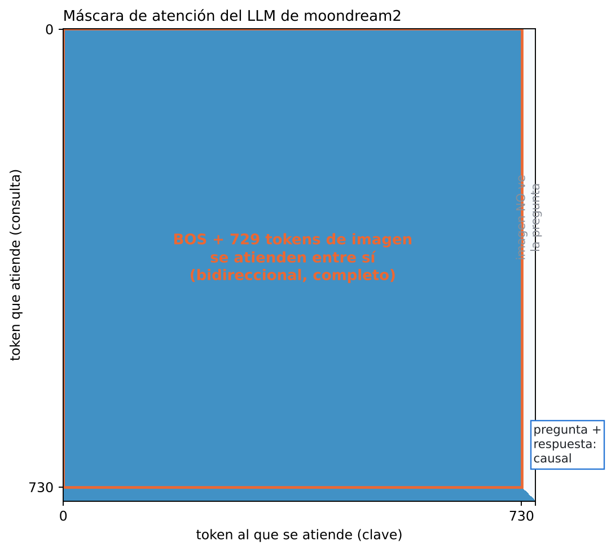

*Figura 3 (propia). Los 730 primeros tokens (BOS + imagen) se atienden entre sí por completo. La pregunta y la respuesta que vienen después son causales: ven a la imagen y a lo anterior, pero la imagen **no ve la pregunta**.*

Implicancias:

- La imagen se codifica **una sola vez** sin saber qué se preguntará (por eso `encode_image` guarda el resultado en una *KV-cache* y se reutiliza con varias preguntas; mira la celda 21 de `anatomia_moondream2.ipynb`).
- La **pregunta sí ve la imagen**: es ahí donde se decide el número. Por eso Grad-CAM se calcula con una pasada completa **que incluye la pregunta**, y depende de ella, mientras el rollout del encoder no.

Una particularidad del código: el bloque del LLM es de tipo *paralelo* (`x = x + attn(l_in) + mlp(l_in)`, ambos a partir de la **misma** normalización), no el clásico secuencial del encoder. No cambia nada conceptual, pero importa si algún día reimplementas el forward (como hiciste en el notebook 03).

### 3.6 Paso 5 · De los logits a la respuesta (y a los puntos)

🔧 Para `query()`: se calcula el logit del siguiente token, se toma el *argmax* (con `temperature=0`) o se muestrea (por defecto `temperature=0.5, top_p=0.3`, `max_tokens=768`), se agrega a la secuencia y se repite hasta el token de fin. Para `point()` el mecanismo es distinto (una cabeza de coordenadas): lo detallo en §5.

### 3.7 ¿Cuánto mide una figura comparada con un token?

Es el dato que explica varias cosas de tus resultados.

- La imagen tiene 1024 px y la grilla 27 → **un token ≈ 38 px de la imagen original**.
- Tus figuras miden **35 px**. O sea: **una figura es más chica que un token**.
- En la vista global (378 px), un token mide 14 px y la figura $35\cdot378/1024\approx 12{,}9$ px (Memoria §3.4).

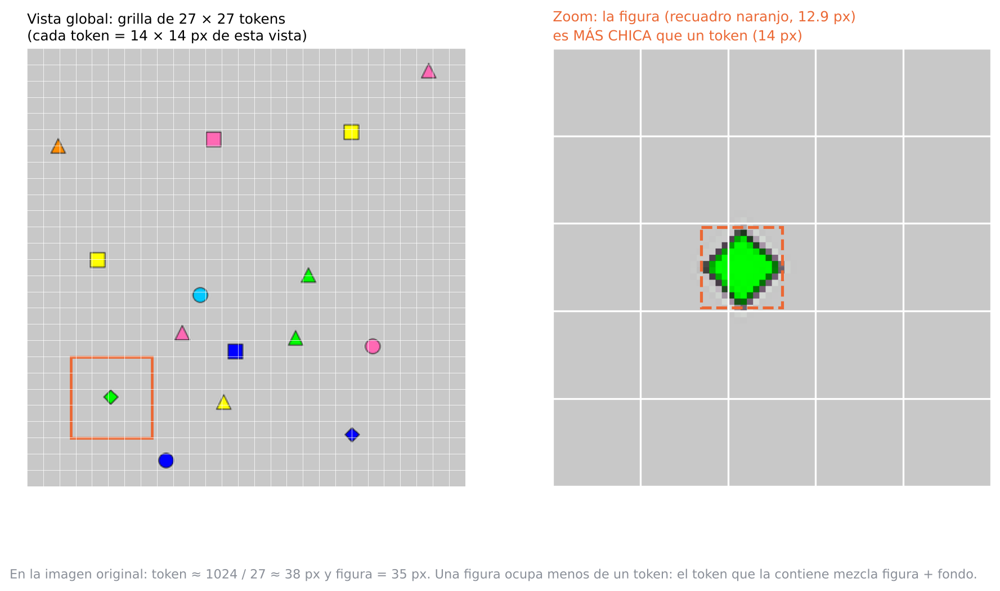

*Figura 4 (propia, imagen q002). Izquierda: la grilla de 27×27 de la vista global. Derecha: acercamiento a una figura, que cabe dentro de un token (o a caballo entre dos). Un token contiene "figura + fondo" mezclados.*

Consecuencia: ningún mapa de 27×27 puede "contornear" una figura. A lo más puede decir "en este token hay algo". Y para el Grad-CAM, un token de figura casi nunca es una región "pura": ver el enriquecimiento (Ec. 3.11) en §7.

### 3.8 Tabla resumen: qué técnica toca qué

| Técnica | Toca… | Forma del dato | Depende de la pregunta | Dónde está en el código |
|---|---|---|---|---|
| Oclusión | La imagen de entrada | 1024×1024×3 (4 versiones) | Sí (se pregunta igual) | `explicabilidad_utils.dibujar()` + `model.query()` |
| Grounding | La salida de la cabeza de coordenadas | lista de (x, y) ∈ [0,1]² | Sí (el objeto se nombra) | `model.point()` |
| Rollout | Atención del encoder, recorte global | 27 capas × 16 cabezas × 729×729 | **No** | notebook 02, `encoder_instrumentado()` |
| Grad-CAM / g×e | Los 729 tokens de 2048 que entran al LLM | 729×2048 (+ gradiente igual) | Sí | notebook 03, `gradcam()` |


---

## 4. Técnica 1 · Oclusión

### 🧒 Versión niño de 5 años

*Le muestras al modelo una mesa con juguetes y preguntas: "¿cuántos triángulos hay?". Dice "4". Ahora, sin que mire, **sacas un triángulo** y le preguntas otra vez. Si de verdad estaba contando, ahora dirá "3". Si dice "4" otra vez, quizás no estaba contando esos triángulos. Y como prueba de que no se asusta por cualquier cambio, también sacas **un círculo** (que no era lo que preguntabas): ahí la respuesta no debería cambiar.*

### 🔧 Cómo funciona

1. Tienes una función $f$ (el modelo): entra una imagen + pregunta, sale una respuesta.
2. **Perturbas** la entrada (borras una parte de la imagen).
3. Comparas la respuesta nueva con la original. La diferencia mide **cuánto dependía** la respuesta de esa parte.

Es la técnica más simple y la **única de las cuatro que es una intervención**: no interpreta nada del interior, cambia el mundo y mira.

En tu experimento (memoria §3.4), cada pregunta se hace sobre **4 versiones** de la imagen, redibujadas desde la lista de figuras (no con parches grises encima):

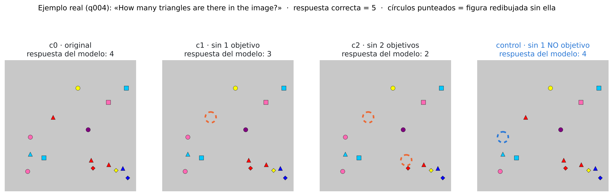

*Figura 5 (propia, caso real q004 de tu conjunto). Original (4), sin un triángulo (3), sin dos triángulos (2), y control sin una figura que no es triángulo (4). Es el ejemplo "cuenta" de la memoria (Figura 30A).*

| Condición | Qué se hace | Qué debería pasar si el modelo **cuenta** |
|---|---|---|
| **c0** | Imagen original | (línea base) |
| **c1** | Sin **1** figura objetivo | La respuesta baja en **1** |
| **c2** | Sin **2** figuras objetivo | La respuesta baja en **2** |
| **control** | Sin **1** figura **no** objetivo | La respuesta **no cambia** |

El **control** es lo que hace válida la prueba. Sin él, no sabrías si el modelo reacciona *a esa figura* o *a cualquier cambio* (menos figuras, otro fondo, otra densidad).

### 📐 Matemática

**Definición (Ec. 2.23).** Si $x_{-S}$ es la imagen sin el conjunto de figuras $S$:

$$\Delta(S)=f(x_{-S})-f(x)$$

**Qué predice cada hipótesis (Ec. 3.4–3.6).** Escribimos la respuesta del modelo con la regresión $\hat y=\beta_0+\beta_1 y$, donde $y$ es el número correcto de figuras:

- $H_C$ (cuenta): $\hat y = y$, es decir $\beta_0=0,\ \beta_1=1$.
- $H_E$ (estima): $0<\beta_1<1$. La respuesta crece con la verdad, pero **más lento**.

Borrar $k$ figuras objetivo baja el número correcto de $y$ a $y-k$. Entonces:

$$\Delta_k=\hat y(y-k)-\hat y(y)=\big[\beta_0+\beta_1(y-k)\big]-\big[\beta_0+\beta_1 y\big]=-\beta_1 k$$

Bajo $H_C$ eso es $-k$; bajo $H_E$ es $-\beta_1 k$. **Esta es la deducción de la Ec. 3.6**: la pendiente de la oclusión debe ser $-1$ si cuenta y $\approx -\beta_1$ si estima. Con ella conectas las dos pruebas (la regresión en la imagen original y la oclusión): son dos medidas de la **misma pendiente**.

**Pendiente por pregunta (Ec. 3.7).** Para cada pregunta se ajusta una recta por mínimos cuadrados a los puntos $(k,\hat y_k)$ con $k\in\{0,1,2\}$. Con tres puntos equiespaciados la pendiente de MCO es:

$$b=\frac{\sum_k (k-\bar k)(\hat y_k-\bar{\hat y})}{\sum_k (k-\bar k)^2}=\frac{(-1)(\hat y_0-\bar{\hat y})+0+(+1)(\hat y_2-\bar{\hat y})}{2}=\frac{\hat y_{c2}-\hat y_{c0}}{2}$$

(porque $\bar k=1$ y $\sum(k-\bar k)^2=2$). **Solo depende de c0 y c2**: la respuesta de c1 no entra.

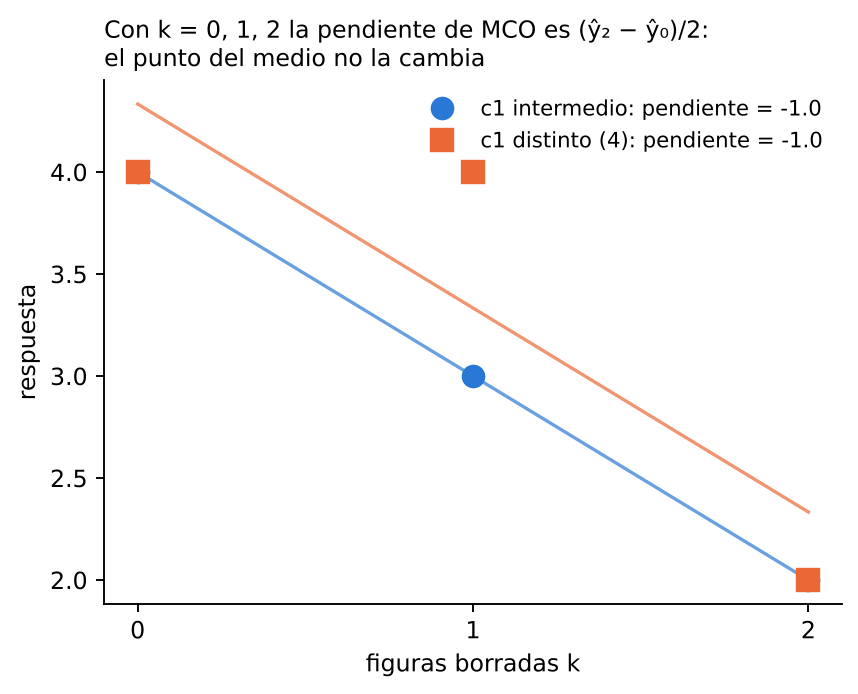

*Figura 6 (propia). Cambiar la respuesta de c1 de 3 a 4 no mueve la pendiente (−1 en ambos casos). Es una propiedad algebraica, no un descuido de la memoria.*

**Comparar c1 contra el control:** ambas condiciones se miden sobre las **mismas preguntas**, así que no son muestras independientes → se usa **McNemar exacto** (Ec. 2.14, §8.2).

### 💻 Código

Las versiones se **redibujan** desde la lista de figuras con la misma regla del generador (`explicabilidad_utils.py`):

```python
def dibujar(objetos, excluir=(), res=1024, grosor=2):
    """Dibuja la escena con las mismas reglas que 2D.py, omitiendo los índices en `excluir`."""
    img = Image.new("RGB", (res, res), FONDO)            # fondo gris 200, igual que el original
    draw = ImageDraw.Draw(img)
    for i, obj in enumerate(objetos):
        if i not in excluir:                             # <- aquí "se borra" la figura: simplemente no se dibuja
            _dibujar_figura(draw, obj, GEN.COLORS[obj["color"]], COLOR_BORDE, grosor)
    return img
```

Y el bucle de preguntas (notebook 01, resumido). Observa tres decisiones de diseño:

```python
SUFIJO = " Respond with only the integer number."
AJUSTES_QUERY = {"temperature": 0, "max_tokens": 16}     # T=0: misma imagen -> siempre la misma respuesta

def preguntar(enc, pregunta):
    return model.query(enc, pregunta + SUFIJO, settings=AJUSTES_QUERY)["answer"]

for fila in imagenes:                                    # 480 imágenes = 120 preguntas x 4 condiciones
    img = Image.open(...).convert("RGB")
    enc = model.encode_image(img)                        # la imagen se codifica UNA vez...
    cruda = preguntar(enc, p["pregunta"])                # ...y se pregunta sobre ella
    prediccion = extraer_entero(cruda)                   # primer entero de la respuesta
```

1. **`temperature=0`**: con la configuración por defecto el modelo *muestrea* (T=0,5). Si no fijas T=0, una diferencia entre c0 y c1 podría ser ruido de muestreo y no efecto de la figura borrada. Verificaste que repetir 10 preguntas da respuestas idénticas.
2. **Sufijo "Respond with only the integer number."**: fuerza una respuesta numérica corta (evita el problema de truncamiento que sí tienes en CAPTURe).
3. **Redibujar, no tapar**: si taparas con un cuadro gris, introducirías un objeto nuevo que el modelo podría contar. Esto lo dice la memoria en §2.8.3.

### 📊 Qué salió (memoria §4.7.1, Tabla 8, Fig. 30)

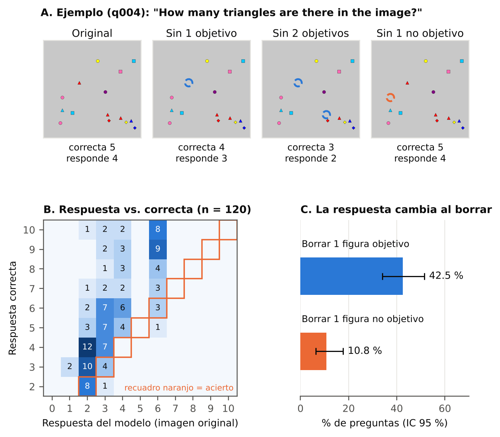

*Figura 30 (memoria): oclusión sobre moondream2, 120 preguntas.*

| Medida | Resultado | Cómo se lee |
|---|---|---|
| Acierto en la imagen original | 12,5 % [7,7–19,6] | Cuenta mal casi siempre; de menos en el 85,8 % |
| Respuestas posibles del modelo | solo 1, 2, 3, 4, 6 | Nunca dice 5, ni más de 6 (aunque la verdad llegue a 10) |
| Respuesta cambia al borrar objetivo | 42,5 % [34,0–51,4] | Reacciona... |
| Respuesta cambia al borrar no objetivo (control) | 10,8 % [6,4–17,7] | ...pero a las figuras que se preguntan, no a cualquier cambio |
| McNemar c1 vs control | 43 vs 5, p ≈ 1,4·10⁻⁸ | Diferencia muy significativa |
| Sigue exactamente −1 y −2 | 11 de 120 (9 %) | Casi nunca "cuenta" en sentido estricto |
| $\hat\beta_1$ (respuesta vs correcta) | 0,445 [0,368; 0,523] | Cada figura de más sube la respuesta solo 0,45 |
| Pendiente de la oclusión (media de $b$) | −0,433 [−0,513; −0,354] | Prácticamente $-\hat\beta_1$ |

Reproduje estas cifras desde `por_pregunta.csv` (Apéndice A). El gráfico siguiente es mío y usa tus datos reales:

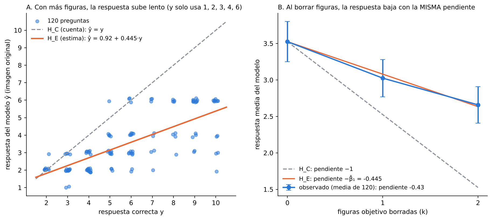

*Figura 7 (propia). **A:** respuesta del modelo vs respuesta correcta. Solo usa 1, 2, 3, 4 y 6, y la recta de ajuste (naranja) está muy bajo la de "cuenta" (gris). **B:** al borrar figuras la respuesta baja con pendiente −0,43, casi igual a $-\hat\beta_1=-0{,}445$ que predice $H_E$ (Ec. 3.6), y lejos de −1.*

**Lectura:** el modelo reacciona *de forma específica* a las figuras preguntadas (por eso no es una heurística puramente ciega a la imagen), pero lo hace con una **escala comprimida**: estima, no cuenta.

### ⚠️ Límites (esto es lo que hay que saber defender)

- **Efecto techo o piso, no necesariamente "estimación".** La propia memoria lo reconoce: formulaste el contraste $H_C$ vs $H_E$ **después** de ejecutar el experimento (§3.4). Que la pendiente sea 0,45 es compatible con "estima en escala comprimida", pero también con "satura en 6 y rara vez usa 5". No son lo mismo.
- **Rango limitado.** Solo preguntas con respuesta correcta entre 2 y 10, y solo moondream2. No es una conclusión sobre VLMs pequeños en general.
- **Quitar una figura cambia levemente la imagen** (densidad, espacio libre). El control mitiga el efecto, no lo elimina.
- **La respuesta es discreta y gruesa.** Con solo 5 valores posibles, que "no cambie" puede ser porque la perturbación es chica frente al escalón del modelo, no porque la figura no importe.
- **Es distribución distinta.** Una imagen con una figura menos es una imagen que el modelo nunca vio; la respuesta puede cambiar por razones no relacionadas con el conteo.

### 📚 Papers

| Paper | Qué buscar |
|---|---|
| **Zeiler & Fergus (2014)**, *Visualizing and Understanding Convolutional Networks*, ECCV (arXiv:1311.2901) | La figura donde tapan una parte de la imagen con un cuadro gris deslizante y grafican la probabilidad de la clase correcta como mapa. Es el origen de la técnica. Busca el apartado *Occlusion Sensitivity*. |
| **Fong & Vedaldi (2017)**, *Interpretable Explanations of Black Boxes by Meaningful Perturbation*, ICCV (arXiv:1704.03296) | Optimizar la máscara que más reduce la salida. Generaliza la oclusión. |
| **Petsiuk et al. (2018)**, *RISE: Randomized Input Sampling for Explanation*, BMVC (arXiv:1806.07421) | Oclusión con muchas máscaras aleatorias, para modelos caja negra. |
| **Selvaraju et al. (2017)**, Grad-CAM | Evalúan Grad-CAM **contra** mapas de oclusión; es el antecedente de tu validación cruzada (§7.7). |

Tu memoria cita a Zeiler y Fergus (2014) y a Selvaraju et al. (2017).

---

## 5. Técnica 2 · Grounding con `point()`

### 🧒 Versión niño de 5 años

*Le dices al modelo: "señala con el dedo todos los triángulos". Si los señala bien, **sabe dónde están**. Pero cuando le preguntas "¿cuántos triángulos hay?" a veces responde un número que no coincide con los dedos que levantó. En tu experimento señaló 7 de 9 triángulos con el dedo, pero cuando le preguntaste cuántos eran, dijo "4". Sabe ver, pero se enreda al sumar.*

### 🔧 Cómo funciona

`point()` es una **habilidad aparte** de `query()`. No devuelve un mapa de calor: devuelve una **lista de coordenadas** $(x,y)$ en $[0,1]^2$. Se la entrena para eso (ver Molmo/PixMo en 📚, al final de esta sección, que usa el señalar como paso para contar).

El mecanismo, que es lo menos conocido y lo más importante de entender (código real de `_generate_points`):

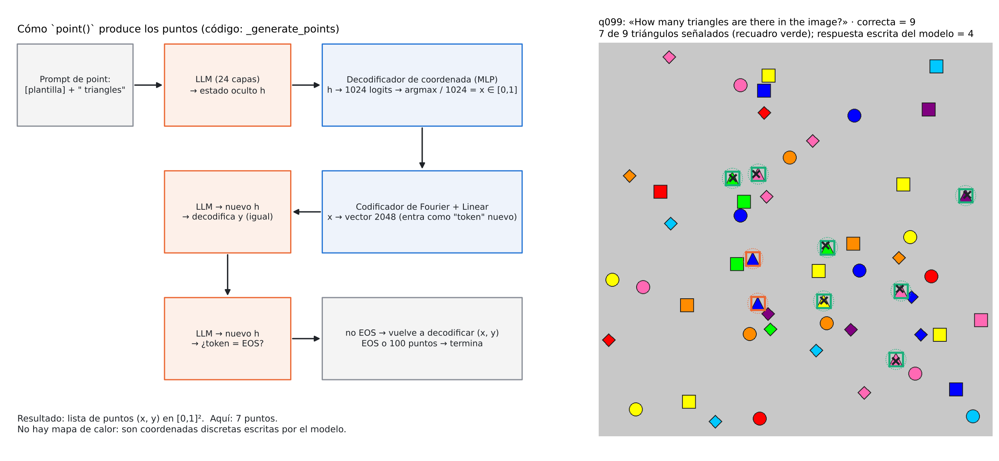

*Figura 8 (propia). Izquierda: el bucle de `point()`. Derecha: caso real q099 de tu conjunto (7 de 9 triángulos señalados, respuesta escrita 4).*

1. El prompt es la plantilla de `point` + el objeto (`" triangles"`). El LLM la procesa con la imagen delante y produce un **estado oculto** $h$.
2. Un **decodificador de coordenada** (un MLP) transforma $h$ en **1024 logits** (1024 "casilleros" entre 0 y 1). Se toma el argmax y se divide por 1024: eso es **x**.
3. Esa $x$ se vuelve a convertir en un vector (**características de Fourier** + una capa lineal) y se **inyecta como un token nuevo**. El LLM produce un nuevo $h$ → se decodifica **y**.
4. El LLM produce un nuevo $h$ y se mira si el siguiente token es **EOS** (fin). Si no, se repite desde el paso 2 con otro punto.
5. Termina en EOS o al llegar a `max_objects` (por defecto 50; tu notebook lo fija en 100).

### 💻 Código

Fuente real de moondream2 (`moondream.py`), recortado:

```python
while next_token.item() != eos_id and len(out) < max_objects:
    x_logits = decode_coordinate(hidden, self.region)            # [1024] logits para la coordenada x
    x_center = torch.argmax(x_logits, dim=-1) / x_logits.size(-1)  # casillero -> número en [0,1]
    next_emb = encode_coordinate(x_center, self.region)          # x -> embedding (Fourier + Linear)
    _, hidden = self._decode_one_tok(next_emb, mask, pos_ids, lora)   # el LLM "lee" la x que escribió
    y_logits = decode_coordinate(hidden, self.region)            # idem para y
    y_center = torch.argmax(y_logits, dim=-1) / y_logits.size(-1)
    ...
    out.append({"x": x_center.item(), "y": y_center.item()})
    ...
    next_token = torch.argmax(logits, dim=-1)                    # ¿EOS? si no, otro punto
```

Y tu código para pedirlos y asignarlos a figuras (notebook 01 y `analizar_conducta.py`):

```python
def apuntar(enc, objeto):
    return model.point(enc, objeto, settings={"max_objects": 100})["points"]

def grounding(p, puntos, objetos):
    objetivo = {i for i, o in enumerate(objetos) if o[clave] == p["objetivo"]}       # figuras que SÍ son el objetivo
    centros = np.array([[o["x"] + o["tamano"]/2, o["y"] + o["tamano"]/2] for o in objetos])
    for pt in puntos:
        xy = np.array([pt["x"] * 1024, pt["y"] * 1024])           # de [0,1] a píxeles
        dist = np.linalg.norm(centros - xy, axis=1)               # distancia a todos los centros
        i = int(dist.argmin())                                    # la figura más cercana
        if dist[i] > 0.75 * lado:      en_fondo += 1              # lejos de todo: punto en el fondo
        elif i in objetivo:            en_objetivo += 1; tocadas.add(i)
        else:                          en_otra += 1               # cayó sobre una figura que NO es el objetivo
```

### 📐 Matemática (Ec. 3.8–3.10)

**Regla de asignación (3.8).** Un punto $u$ se asigna a la figura $j$ más cercana si

$$d(u,c_j)<0{,}75\,s$$

con $c_j$ el centro del cuadrado que contiene a la figura y $s$ su lado (35 px). **Por qué 0,75:** el punto más lejano del centro dentro del cuadrado es una esquina, a $s/\sqrt2\approx0{,}707\,s$. Con 0,75 se cubre la figura completa con un pequeño margen. Si hay dos figuras solapadas, gana la más cercana.

**Métricas (3.9 y 3.10).** Con $P$ el conjunto de puntos devueltos y $O$ el de figuras objetivo:

$$\text{precisión}=\frac{|\{u\in P: u\text{ se asigna a una figura de }O\}|}{|P|}\qquad \text{cobertura}=\frac{|\{j\in O: j\text{ recibe al menos un punto}\}|}{|O|}$$

- **Precisión:** de los puntos que puso, ¿cuántos cayeron en una figura objetivo? ("¿dónde apunta bien?")
- **Cobertura:** de las figuras objetivo que existen, ¿a cuántas apuntó? ("¿cuántas encontró?")

**Conteo por puntos** $\hat y_{pt}$ = número de figuras objetivo que reciben **al menos un punto** (el numerador de la cobertura). Así, varios puntos sobre la misma figura no inflan el conteo.

**Por qué 1024 casilleros bastan:** la resolución es $1/1024$ de la imagen ≈ 1 px; la figura mide 35 px. La precisión del punto no es el cuello de botella.

### 📊 Qué salió (memoria §4.7.2, Fig. 31)

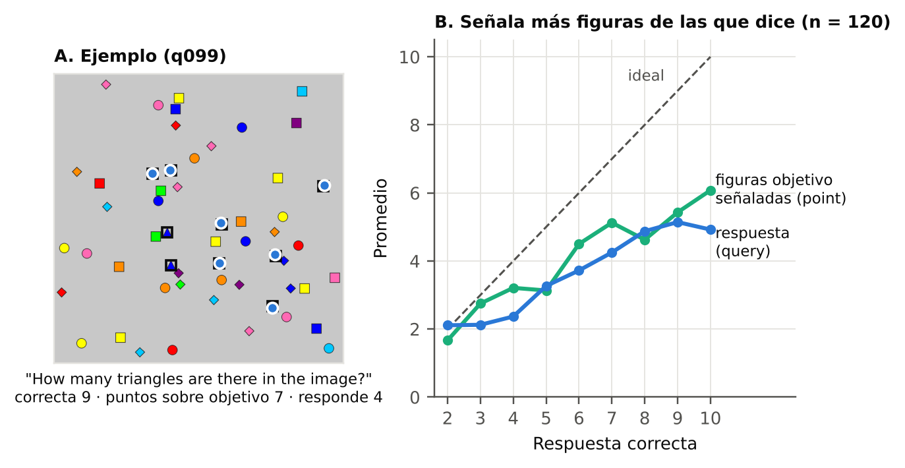

*Figura 31 (memoria): grounding con `point()`.*

| Medida | Resultado |
|---|---|
| Puntos que caen sobre una figura objetivo (precisión) | 77,0 % de 790 puntos |
| Figuras objetivo encontradas (cobertura) | 68,6 % de 701 |
| Conteo por puntos exacto | **27,5 %** de las preguntas |
| Respuesta escrita (`query`) exacta | 12,5 % |
| Solo acierta el conteo por puntos / solo la respuesta escrita | 25 vs 7 (McNemar p = 0,002) |

Dato a tener a mano: estas cifras incluyen **2 llamadas degeneradas** que devolvieron 100 puntos cada una (el máximo). Sin ellas la precisión sube a 81,9 % y la cobertura queda en 69,1 %.

**Lectura:** el modelo **localiza** bien (≈70 % de las figuras), pero su respuesta escrita no coincide con lo que señala: cuando cuenta con el dedo acierta más del doble que cuando responde con el número. *Interpretación (no es una conclusión de la memoria):* el cuello de botella parece estar más en *agregar* lo visto en un número que en *ver*.

### ⚠️ Límites

- **`point()` no es `query()`.** Que el modelo *pueda* señalar cuando se le pide no prueba que `query()` *use* esa localización al contar. Son caminos distintos del mismo modelo (distinta plantilla, distinta cabeza de salida). El vínculo causal lo aporta la oclusión, no el grounding (memoria §3.4, sección de límites).
- **La asignación punto→figura es una regla mía** (0,75·s, figura más cercana). Es razonable, pero el resultado depende de ella. Una figura solapada con otra puede "quitarle" el punto.
- **Contar con el dedo y contar con el número son tareas distintas** y están entrenadas distinto. Que `point` acierte más no implica que el modelo "sepa contar mejor", sino que ese camino es más fiable para esta tarea.
- **Casos degenerados:** el modelo a veces no emite EOS y llena los 100 puntos.

### 📚 Papers

| Paper | Qué buscar |
|---|---|
| **Código y ficha de moondream2** (Korrapati, 2025) | `point()`, `detect()`; no hay paper formal. |
| **Deitke et al. (2024)**, *Molmo and PixMo: Open Weights and Open Data for State-of-the-Art VLMs* (arXiv:2409.17146) | Entrenan al modelo a **señalar** (datos PixMo-Points) y usan ese señalar como paso intermedio para contar. Es la motivación conceptual de `point` como "contar con el dedo". (Verifica en el paper los detalles de cómo lo evalúan antes de citarlo.) |
| **Pothiraj et al. (2025)**, CAPTURe (ICCV) | El benchmark de la memoria; contexto de por qué contar bajo oclusión es difícil. |


---

## 6. Técnica 3 · Attention rollout

### 🧒 Versión niño de 5 años

*Es el juego del "teléfono descompuesto", pero con muchos niños y muchos recreos. En cada recreo (cada **capa**), cada niño le cuenta a los demás lo que sabe y escucha lo que le cuentan. Al final del día, ¿de qué niño inicial viene lo que sabe cada uno? Para saberlo sigues el chisme **hacia atrás**, recreo por recreo. Eso es el rollout.*

*El problema: en tu colegio hay algunos niños "megáfono" (los **attention sinks**) a los que todos escuchan siempre, **sin importar qué chisme se esté contando**. Entonces, aunque cambies la historia, el chisme siempre parece venir de los megáfonos.*

### 🔧 Cómo funciona

**El problema que resuelve.** Mirar la atención de **una sola capa** (por ejemplo, la última) es engañoso: en la última capa, los vectores ya están mezclados con lo que pasó en las 26 anteriores. "El token A atiende al B" en la capa 27 no significa que la información de B llegue a A, porque B ya contiene información de C, D, E... Jain & Wallace (2019) argumentan, además, que la atención ni siquiera es una explicación fiable de la salida.

**La idea del rollout (Abnar & Zuidema, 2020).** Tratar las capas como una **red de caminos** por los que fluye la información y **multiplicar** las matrices de atención capa por capa, para obtener cuánto de cada token de entrada llega a cada token de salida a través de *todos* los caminos posibles. Dos detalles:

1. **Promediar las cabezas** de cada capa (para tener una sola matriz por capa).
2. **Sumar la identidad** (conexión residual): cada token también "se pasa a sí mismo" su información sin pasar por la atención.

Luego se renormaliza para que cada fila siga sumando 1 y se multiplica de la capa 1 a la $L$.

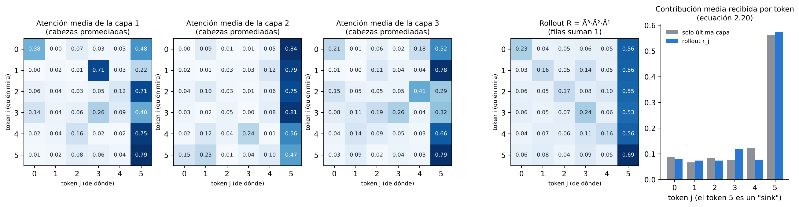

*Figura 9 (propia, ejemplo didáctico con números inventados: 6 tokens y 3 capas). Con un token "sink" (el 5) que recibe mucha atención en todas las capas, el rollout termina dominado por él: la última capa sola ya lo muestra, y el producto acumulado lo confirma.*

### 📐 Matemática (Ec. 2.18–2.20)

**Atención por cabeza** (Ec. 2.18): $\mathbf{A}^{(l,h)}=\mathrm{softmax}\big(\mathbf{Q}^{(l,h)}\mathbf{K}^{(l,h)\top}/\sqrt{d_h}\big)$, de $N_v\times N_v$ con $N_v=729$. Cada fila suma 1.

**Matriz por capa** (Ec. 2.19): se promedian las $H=16$ cabezas, se suma $\mathbf{I}$ y se renormaliza:

$$\tilde{\mathbf{A}}^{(l)}=\tfrac12\Big(\tfrac1H\sum_{h=1}^{H}\mathbf{A}^{(l,h)}+\mathbf{I}\Big)$$

El $\tfrac12$ es exactamente la renormalización: cada fila del promedio de cabezas suma 1 y la de la identidad suma 1, la suma vale 2, así que hay que dividir por 2 para que siga sumando 1. (Abnar & Zuidema usan $0{,}5\,\mathbf{W}_{att}+0{,}5\,\mathbf{I}$, equivalente.)

**Rollout** (Ec. 2.19, segunda parte): el producto de las $L=27$ capas, con las capas más profundas a la **izquierda**:

$$\mathbf{R}=\tilde{\mathbf{A}}^{(L)}\,\tilde{\mathbf{A}}^{(L-1)}\cdots\tilde{\mathbf{A}}^{(1)}$$

$R_{ij}$ estima **cuánto contribuye el token de entrada $j$ al token $i$ de la última capa**. Como cada factor tiene filas que suman 1, $\mathbf{R}$ también (propiedad de las matrices *estocásticas por filas*: el producto de dos matrices cuyas filas suman 1 tiene filas que suman 1).

**Interpretación probabilística.** $R_{ij}$ es la probabilidad de que un "paseante aleatorio" que parte del token $i$ en la última capa y va retrocediendo capa por capa, eligiendo a quién mirar según las probabilidades de $\tilde{\mathbf A}$, termine en el token $j$ en la entrada. (Esta lectura es mía, y es la forma habitual de entender el producto de matrices estocásticas.)

**Mapa por token** (Ec. 2.20). Sin token `[CLS]`, no hay una fila privilegiada que resuma la imagen. Entonces se toma la **contribución media recibida**:

$$r_j=\frac1{N_v}\sum_{i=1}^{N_v}R_{ij}$$

Como las filas de $\mathbf R$ suman 1, se cumple $\sum_j r_j=1$: el mapa es **una distribución** sobre los 729 tokens. Se reordena a 27×27 y se pinta sobre la imagen.

**Ejemplo a mano (didáctico).** 3 tokens, 2 capas, ya con la identidad sumada y normalizada:

$$\tilde{\mathbf A}^{(1)}=\begin{pmatrix}0{,}80&0{,}10&0{,}10\\0{,}05&0{,}90&0{,}05\\0{,}15&0{,}15&0{,}70\end{pmatrix},\quad
\tilde{\mathbf A}^{(2)}=\begin{pmatrix}0{,}60&0{,}05&0{,}35\\0{,}05&0{,}60&0{,}35\\0{,}05&0{,}05&0{,}90\end{pmatrix}$$

$$\mathbf R=\tilde{\mathbf A}^{(2)}\tilde{\mathbf A}^{(1)}=\begin{pmatrix}0{,}535&0{,}158&0{,}308\\0{,}123&0{,}598&0{,}280\\0{,}178&0{,}185&0{,}638\end{pmatrix}\ \ (\text{filas suman }1),\qquad r=(0{,}278;\ 0{,}313;\ 0{,}408)$$

Aunque el token 3 solo recibe 0,10 y 0,05 de atención directa en la capa 1, termina con la mayor contribución media (0,408) porque en la capa 2 todos lo miran mucho (0,35). **El rollout acumula el efecto de varias capas**; mirar una sola capa no lo ve. (Calculé este ejemplo en Python.)

### 💻 Código (notebook 02, anotado)

Como el encoder usa un *kernel* fusionado que **no expone** los pesos de atención, tuviste que **reimplementarlo** línea por línea, con el softmax explícito. Esta es la pieza central:

```python
def atencion_explicita(x, w, n_heads):
    """Igual que layers.attn, pero devuelve también la matriz de atención."""
    bsz, q_len, d_model = x.shape                     # [10 recortes, 729 tokens, 1152]
    hd = d_model // n_heads                           # 72 por cabeza
    q, k, v = [t.view(bsz, q_len, n_heads, hd).transpose(1, 2)
               for t in layers_mod.linear(x, w.qkv).chunk(3, dim=-1)]     # consultas, claves, valores
    a = ((q.float() @ k.float().transpose(-2, -1)) / hd ** 0.5).softmax(dim=-1)   # Ec. 2.18  [10,16,729,729]
    out = (a.to(v.dtype) @ v).transpose(1, 2).reshape(bsz, q_len, d_model)
    return layers_mod.linear(out, w.proj), a          # salida normal + la matriz que queríamos ver

def encoder_instrumentado(crops):
    w = md.vision
    x = vision_mod.create_patches(crops, 14)
    x = w.patch_emb(x) + w.pos_emb
    eye = torch.eye(x.shape[1], device=x.device)      # la identidad I (729x729)
    rollout = eye.clone()                             # empieza en I: "antes de la capa 1 cada token es él mismo"
    for block in w.blocks:                            # 27 capas
        salida, a = atencion_explicita(vision_mod.layer_norm(x, block.ln1), block.attn, 16)
        x = x + salida                                # residual de la atención
        x = x + vision_mod.mlp(vision_mod.layer_norm(x, block.ln2), block.mlp)   # residual del MLP
        capa = a[0].mean(dim=0) + eye                 # a[0] = recorte 0 (el GLOBAL); mean(0) = promedio de las 16 cabezas; + I
        rollout = (capa / capa.sum(dim=-1, keepdim=True)) @ rollout   # normaliza filas y multiplica: Ã^(l) · R^(l-1)
    ...
# después:  recibido = rollout.mean(dim=0)    # Ec. 2.20: promedio sobre las filas i -> r_j
```

Tres cosas para notar:

- **`a[0]`** es el recorte 0: el rollout se calcula solo sobre la **vista global**, que cubre toda la imagen.
- **El orden del producto**: `(capa_normalizada) @ rollout`. La capa **nueva** va a la izquierda, igual que en $\mathbf R=\tilde{\mathbf A}^{(L)}\cdots\tilde{\mathbf A}^{(1)}$.
- **Verificación**: una celda comprueba que la reimplementación da **la misma salida** que el encoder original (diferencia máxima 0; coseno mínimo 0,9999996 entre tokens). Sin ese chequeo, todo el análisis sería sospechoso.

**Los controles** (imagen gris sin figuras e imagen de ruido) y el registro de la **norma por token** (para los *sinks*):

```python
normas.append(x[0].float().norm(dim=-1))             # norma L2 de cada token tras cada capa
```

### 📊 Qué salió (memoria §4.7.3, Fig. 32)

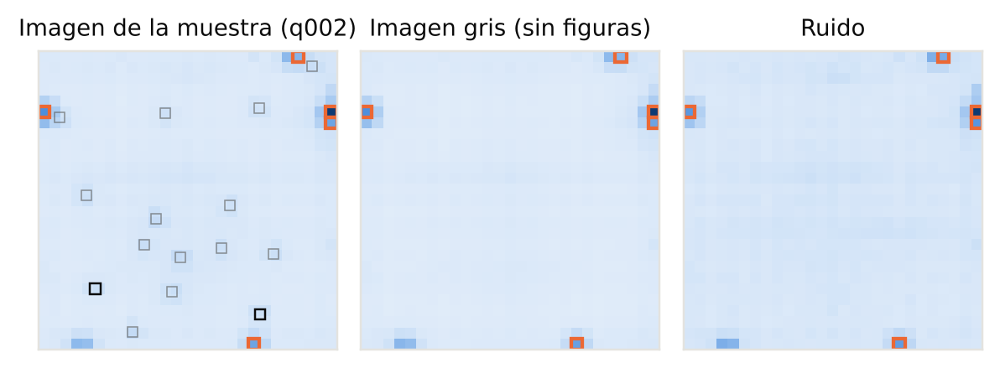

*Figura 32 (memoria): rollout en q002, en una imagen gris y en ruido. Los recuadros naranjos son los 5 tokens de mayor rollout en la gris.*

Y aquí van los mismos mapas con sus normas, a partir de tus `mapas_rollout.npz`:

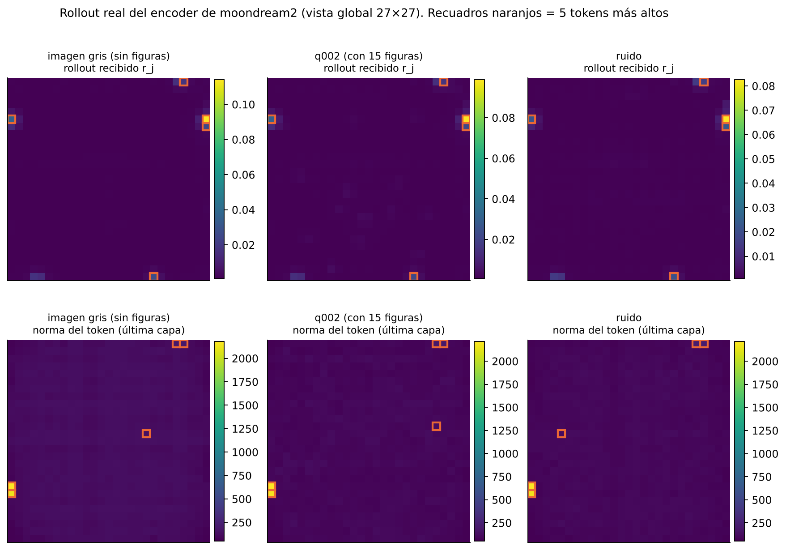

*Figura 10 (propia, datos reales). Fila superior: rollout recibido. Fila inferior: norma del token en la última capa. **Los puntos calientes son los mismos en la imagen gris (sin figuras), en q002 (con 15 figuras) y en el ruido.** Son tokens de los bordes con norma muy alta (~2000 vs ~200 el resto).*

| Medida | Resultado |
|---|---|
| Los 5 tokens de mayor rollout | **los mismos** en las 22 imágenes, incluida la gris y el ruido |
| Tokens fijos (5 de rollout + 4 de norma, uno repetido) | 8 tokens = 1,1 % del total, concentran **19,4 %** de la masa |
| Correlación del mapa de cada imagen con el de la gris | 0,997 (0,957 sin esos tokens) |
| Enriquecimiento de las figuras | 1,5 (1,8 sin los tokens fijos); figuras objetivo no se distinguen de las demás |

(Comprobé en tus `mapas_rollout.npz` que los 5 tokens de mayor rollout son idénticos entre la imagen gris y q002, y la correlación 0,997.)

**Lectura.** El rollout del encoder está **dominado por posiciones fijas** (*attention sinks*) y **no depende de la pregunta ni de las figuras objetivo**, como es esperable porque el encoder no recibe la pregunta. Por eso **no sirve para saber qué usa el modelo para contar**. Es un resultado *negativo pero informativo*: documenta con controles un artefacto conocido.

### ⚠️ Límites

- **Atención ≠ explicación.** Que dos tokens se atiendan no prueba que uno "use" al otro para la respuesta (Jain & Wallace, 2019). Wiegreffe & Pinter (2019) matizan, pero la cautela se mantiene.
- **Solo ve el encoder, solo el recorte global.** Los 9 recortes locales y el LLM (donde se decide el número) quedan fuera.
- **Promediar cabezas es una decisión.** Cada cabeza hace algo distinto (algunas atienden a posición, otras a contenido); promediarlas mezcla funciones. Chefer et al. (2021) proponen una alternativa que pondera por gradiente.
- **Los *attention sinks* no son un error del rollout**: son una propiedad del modelo. Darcet et al. (2024) muestran que los ViT grandes y bien entrenados "reciclan" algunos tokens de baja información como **memoria global** (tokens de norma altísima). El rollout simplemente los hace visibles.
- **Un valor alto de rollout en el fondo no prueba que el fondo sea inútil.** Con parcheo causal, se ha visto que parches de fondo pueden llevar más señal de conteo que los de objeto (CountScope, según tu búsqueda del 9-nov). Matiz para interpretar.

### 📚 Papers

| Paper | Qué buscar |
|---|---|
| **Abnar & Zuidema (2020)**, *Quantifying Attention Flow in Transformers*, ACL (arXiv:2005.00928) | La §2 define **attention rollout** y **attention flow** (flujo máximo). Mira la figura que compara rollout con la atención cruda. |
| **Vaswani et al. (2017)**, *Attention Is All You Need* (arXiv:1706.03762) | La definición de atención (Ec. 2.18). |
| **Darcet et al. (2024)**, *Vision Transformers Need Registers*, ICLR (arXiv:2309.16588) | Por qué aparecen tokens de norma alta en regiones de poca información y cómo agregar tokens "registro" los arregla. Es el paper que explica tu Fig. 32. |
| **Xiao et al. (2023)**, *Efficient Streaming Language Models with Attention Sinks* (arXiv:2309.17453) | El mismo fenómeno de *sinks* en LLMs. |
| **Jain & Wallace (2019)**, *Attention is not Explanation*, NAACL (arXiv:1902.10186) | El argumento de fondo. Tu §4.7.5 lo cita. |
| **Wiegreffe & Pinter (2019)**, *Attention is not not Explanation*, EMNLP (arXiv:1908.04626) | La réplica matizada. |
| **Chefer, Gur & Wolf (2021)**, *Transformer Interpretability Beyond Attention Visualization*, CVPR (arXiv:2012.09838) | Mejora del rollout con relevancia y gradiente (lectura opcional, útil para trabajo futuro). |
| **Adebayo et al. (2018)**, *Sanity Checks for Saliency Maps*, NeurIPS (arXiv:1810.03292) | La lógica de los **controles** (imagen gris, ruido): un buen mapa debe cambiar cuando cambia la entrada. |

---

## 7. Técnica 4 · Grad-CAM y gradiente × entrada

### 🧒 Versión niño de 5 años

*Imagina que los 729 "niños de la imagen" le susurran al modelo, y cada niño tiene 2048 perillas de volumen. El modelo, al final, dice "4". Para saber **a quién hizo caso**, giras un poquito cada perilla de cada niño y miras cuánto cambia el puntaje que el modelo le da a "4". Las perillas que más lo mueven son las que más importaron.*

*Dos formas de usar eso:*
- ***Grad-CAM:*** *primero promedias qué **perillas** (de las 2048) importan en general, para todos los niños juntos. Después miras qué niños tienen esas perillas altas. Es como decir "en general, las perillas 7 y 120 son importantes", y premiar a los niños que las tienen fuertes.*
- ***Gradiente × entrada:*** *no promedias. Para cada niño miras **sus propias** perillas, cuánto valen y cuánto mueven el puntaje, y las sumas.*

*Problema: de los 729 niños, ~97 % está mirando un fondo gris. Si "en general" quiere decir "lo que dicen casi todos", Grad-CAM termina premiando a los del fondo, que son la mayoría.*

### 🔧 Cómo funciona

1. Se hace **una pasada completa** del modelo, con imagen **y** pregunta, **con gradientes activados**. Se anota el número que el modelo elige (el *argmax*).
2. Se toma el **logit de ese primer token de respuesta**, $s_{y^*}$ (**antes** del softmax), y se llama a `backward()`.
3. PyTorch calcula $\partial s_{y^*}/\partial E_{tc}$ para **cada uno de los 729 tokens** $t$ y **cada uno de sus 2048 canales** $c$: es el tensor $\mathbf g$ de 729×2048.
4. Se combinan $\mathbf g$ y $\mathbf E$ de dos maneras (Grad-CAM y gradiente×entrada) para dar un mapa de 729 valores = 27×27.

**Por qué el logit y no la probabilidad.** El softmax *satura*: si el modelo ya está seguro, su gradiente es casi cero aunque la imagen importe mucho. El logit crudo no satura. Selvaraju et al. usan igualmente el puntaje **antes del softmax**.

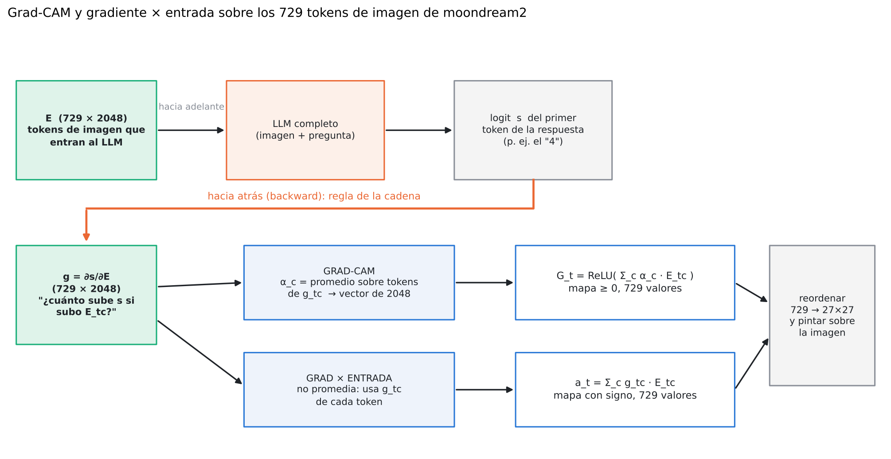

*Figura 11 (propia). Arriba: la pasada hacia adelante (E → LLM → logit). Flecha naranja: la retropropagación que produce $\mathbf g=\partial s/\partial\mathbf E$. Abajo: las dos maneras de combinar $\mathbf g$ y $\mathbf E$.*

### 📐 Matemática (Ec. 2.21, 2.22)

**Grad-CAM original** (Selvaraju et al., 2017), para una red convolucional: sea $A^k_{ij}$ el mapa de características $k$ de la última capa convolucional y $y^c$ el puntaje (pre-softmax) de la clase $c$.

$$\alpha^c_k=\frac1Z\sum_{i}\sum_{j}\frac{\partial y^c}{\partial A^k_{ij}},\qquad L^c_{\text{Grad-CAM}}=\mathrm{ReLU}\Big(\sum_k \alpha^c_k A^k\Big)$$

- $\alpha^c_k$ es la **importancia del canal $k$**: el gradiente **promediado espacialmente** (*global average pooling* de los gradientes).
- Se hace la combinación lineal de los canales ponderada por esa importancia, y se aplica **ReLU** para quedarse **solo con lo que empuja a favor** de la clase.
- El resultado tiene la resolución del mapa de características (para una CNN, chica) y se sobremuestrea.

**Adaptación a moondream2 (tu Ec. 2.21).** Aquí no hay mapas de características convolucionales: lo que hay son los **$N_v=729$ embeddings** que entran al LLM, $E_{t,c}$ (token $t$, canal $c$ de 2048). Se hace la traducción directa: "canal $k$" → "canal $c$", y "promedio espacial" → "promedio sobre los 729 tokens":

$$\alpha_c=\frac1{N_v}\sum_{t=1}^{N_v}\frac{\partial s_{y^*}}{\partial E_{t,c}},\qquad G_t=\mathrm{ReLU}\Big(\sum_c \alpha_c\,E_{t,c}\Big)$$

**Gradiente × entrada** (Ec. 2.22; Shrikumar et al., 2017) **no promedia** el gradiente entre tokens:

$$a_t=\sum_c\frac{\partial s_{y^*}}{\partial E_{t,c}}\,E_{t,c}$$

Es el término de primer orden de la expansión de Taylor: $s(\mathbf E)-s(\mathbf 0)\approx\sum_{t,c}g_{tc}E_{tc}=\sum_t a_t$, es decir, **la suma de los $a_t$ aproxima cuánto vale $s$** si se parte de una entrada nula. Con signo: positivo = empuja a favor del número elegido; negativo = en contra. (Es solo una aproximación: la red no es lineal; Integrated Gradients, Sundararajan et al. 2017, corrige esa falta de "completitud".)

#### Deducción propia: por qué Grad-CAM favorece al fondo (y gradiente×entrada no)

*Esto no está en la memoria: es álgebra que respalda su explicación de §4.7.4 ("$\alpha_c$ promedia sobre los tokens, de los cuales ~97 % es fondo").*

La suma de gradiente×entrada sobre todos los tokens y canales se puede separar así (identidad de la covarianza: $\sum_t g_tE_t=N\,\bar g\bar E+\sum_t(g_t-\bar g)(E_t-\bar E)$, canal por canal):

$$\sum_t a_t=\underbrace{N_v\sum_c\bar g_c\,\bar E_c}_{\text{lo que “ve” Grad-CAM}}+\underbrace{\sum_c\sum_t\big(g_{tc}-\bar g_c\big)\big(E_{tc}-\bar E_c\big)}_{\text{lo que Grad-CAM descarta}}$$

con $\bar g_c=\alpha_c$ el gradiente medio y $\bar E_c$ el valor medio. Grad-CAM usa $\alpha_c=\bar g_c$ para **todos** los tokens: **conserva solo el primer término** y pierde la parte donde el gradiente de *cada token* se alinea con *su propio* valor (el segundo). Si 97 % de los tokens es fondo, $\bar g$ **es** el gradiente del fondo. Una figura (el 0,4 % del área) tiene su propio patrón de gradiente, que ese promedio diluye.

**Ejemplo con números (didáctico).** 10 tokens y 2 canales. Nueve tokens de fondo con $E=(1,0)$ y $g=(1,0)$; un token de "figura" con $E=(0,2)$ y $g=(0,3)$ (su señal vive en el otro canal). El gradiente medio es $\alpha=\bar g=(0{,}9;\ 0{,}3)$.

| | Fondo (×9) | Figura (×1) |
|---|---|---|
| **Grad-CAM** $=\mathrm{ReLU}(\alpha\cdot E_t)$ | **0,9** | **0,6** |
| **Grad × entrada** $=g_t\cdot E_t$ | 1 | **6** |

Grad-CAM pone **a la figura por debajo del fondo** (0,6 < 0,9); gradiente×entrada la pone **6 veces arriba**. Y se cumple la descomposición: $\sum a_t=15=8{,}7\ (\text{primer término})+6{,}3\ (\text{covarianza})$. (Verificado en Python.) Es un caso de juguete, pero reproduce exactamente el patrón que obtuviste.

### 💻 Código (notebook 03, anotado)

*Versión resumida: dejé fuera el armado de los ids de texto; el código completo está en la celda 4 de `03_gradcam_moondream2.ipynb`.*

```python
def gradcam(imagen, pregunta):
    """Una pasada con gradientes: imagen + pregunta -> logit del primer token de respuesta -> mapas."""
    captura = {}
    vis_enc_original = md._vis_enc
    def vis_enc_con_captura(x):                       # "gancho": intercepta la salida del encoder visual
        salida = vis_enc_original(x).detach().requires_grad_(True)   # la convierte en hoja con gradiente
        captura["enc"] = salida
        return salida
    md._vis_enc = vis_enc_con_captura
    try:
        with torch.enable_grad():                     # el modelo viene con no_grad/inference por defecto
            emb = md._run_vision_encoder(imagen)      # [729, 2048]: los tokens de imagen para el LLM
            emb.retain_grad()                         # pedimos guardar emb.grad aunque no sea una hoja
            ids = prefijo + tokenizar(pregunta + SUFIJO) + sufijo
            bos = text_encoder(BOS);  texto = text_encoder(ids)
            x = torch.cat([bos, emb[None], texto], dim=1)      # secuencia: BOS + 729 imagen + pregunta
            mascara = md.attn_mask[:, :, :L, :L]               # imagen bidireccional, texto causal
            for block in md.text.blocks:                       # = text_decoder(), pero SIN caché
                l_in = layer_norm(x, block.ln)
                x = x + attn(l_in, ...) + mlp(l_in, block.mlp) # bloque paralelo del LLM
            logits = lm_head(x, md.text)[0].float()            # logits del último token de la secuencia
            pred = int(logits.argmax())                        # el número que el modelo elegiría
            logits[pred].backward()                            # <<< retropropagación del logit elegido
    finally:
        md._vis_enc = vis_enc_original                # restaura el modelo
    E, G = emb.detach().float(), emb.grad.float()     # E = tokens, G = ∂s/∂E   (ambos 729×2048)
    return dict(
        gradcam_llm = torch.relu((E * G.mean(0)).sum(-1)).cpu().numpy(),   # Ec. 2.21:  ReLU( Σ_c α_c E_tc )
        gxi_llm     = (E * G).sum(-1).cpu().numpy(),                       # Ec. 2.22:  Σ_c g_tc E_tc
        ...
```

Léelo así:
- `G.mean(0)` es $\alpha_c$: promedia sobre la dimensión 0 (los 729 tokens) → vector de 2048.
- `(E * G.mean(0)).sum(-1)` → para cada token, $\sum_c \alpha_c E_{tc}$ → 729 valores.
- `(E * G).sum(-1)` → no promedia: usa el gradiente de **cada** token.
- `model.requires_grad_(False)` (celda 3) apaga los gradientes de los **pesos**: solo interesan los gradientes respecto de la **imagen**.
- **El chequeo clave:** una celda comprueba que esta pasada elige **el mismo número que `model.query()`** (5 de 5). Si no, estarías explicando una respuesta distinta de la que da el modelo.
- Detalle técnico: el modelo se carga en `bfloat16`; el gradiente se calcula en esa precisión y luego se pasa a `float32`. Si algún día comparas con otro framework, conviene saberlo.

### 📊 Qué salió (memoria §4.7.4, Fig. 33)

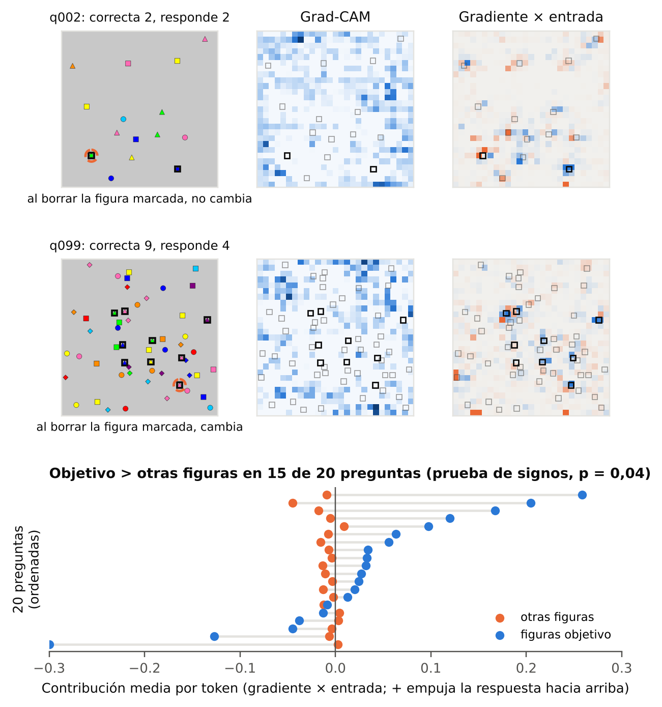

*Figura 33 (memoria): Grad-CAM y gradiente × entrada para q002 (acierto) y q099 (error lejano).*

| Medida (20 preguntas) | Resultado | Lectura |
|---|---|---|
| Grad-CAM, enriquecimiento mediano en **figuras objetivo** | **0,08** | Casi no ve las figuras objetivo |
| …en **otras figuras** | 0,23 | |
| …en el **fondo** | 1,02 | Cercano al máximo posible (1,03) |
| ¿Comparte tokens del top-5 con la imagen gris? | en 19 de 20 casos, **ninguno** | A diferencia del rollout, **sí cambia** con la imagen y la pregunta |
| **Grad × entrada:** objetivo > otras figuras | **15 de 20** (signos p = 0,041; Wilcoxon 0,070) | Señal débil y marginal a favor de las figuras preguntadas |
| Percentil de la figura borrada en el mapa de Grad-CAM | 26 (si la respuesta cambió) vs 5 (si no) | Solo indicativo (Mann-Whitney p = 0,29) |

#### El enriquecimiento (Ec. 3.11) y por qué "1,02 en el fondo" no es un fracaso

Para decir "el mapa se concentra en una región" se mide el **enriquecimiento**: fracción del mapa que cae en la región **dividida por** la fracción del área que ocupa.

$$\mathrm{Enr}(\mathcal R)=\frac{\sum_t m_t\,f_t(\mathcal R)}{\frac1{N_v}\sum_t f_t(\mathcal R)}\ \le\ \frac{1}{\frac1{N_v}\sum_t f_t(\mathcal R)}$$

con $m_t$ el mapa normalizado ($\sum m_t=1$) y $f_t(\mathcal R)$ la fracción del token $t$ cubierta por la región. **1 = el mapa no distingue la región del resto.** Pero la **cota superior** depende del área: una región grande no puede tener un enriquecimiento alto.

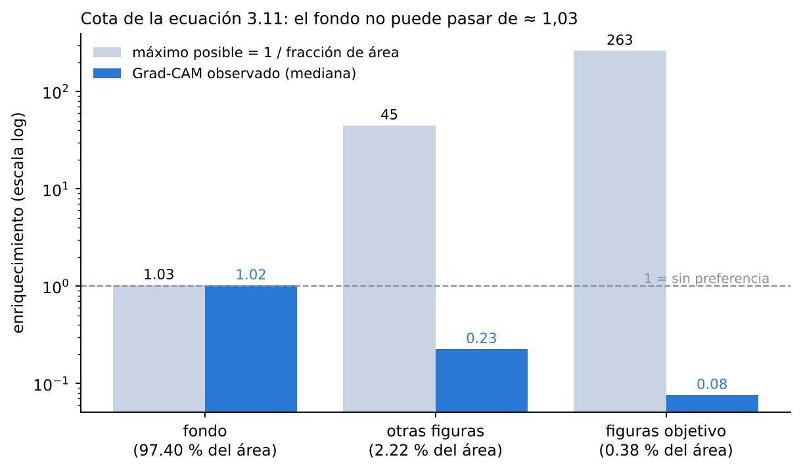

*Figura 12 (propia, con los porcentajes de área de la memoria §3.4; "otras figuras" = 100 − 97,4 − 0,38 %, que calculé yo). El fondo ocupa 97,4 % del área → su enriquecimiento no puede pasar de ≈ 1,03. Un valor de 1,02 significa que **casi toda la masa del mapa cae en el fondo**.*

Es la parte sutil de tu resultado: "enriquecimiento ≈ 1 en el fondo" suena a "no distingue", pero con esa cota significa **"prácticamente todo el mapa está en el fondo"**. Y en las figuras objetivo, 0,08 sobre una cota de ~260 es "casi nada".

### ⚠️ Límites

- **Una sensibilidad local no es una explicación.** El gradiente dice "si muevo $E$ un poquito, $s$ cambia así", no "el modelo usó esta parte". Para saber qué *usa*, hay que intervenir (oclusión). Por eso en tu memoria Grad-CAM se contrasta con la oclusión.
- **Grad-CAM en ViTs/VLMs está subespecificado**: capa elegida, token objetivo, qué se promedia, gradiente o gradiente de atención... Una revisión de 175 papers (arXiv:2608.05258, según tu búsqueda del 9-nov) estima más de 100 mapas posibles para un mismo ViT y recomienda **declarar todas las decisiones**. En tu memoria quedaron declaradas (§3.4).
- **El promedio de $\alpha$ diluye la señal** de objetos chicos (la deducción de arriba). Esto es un problema del *método aplicado a objetos que ocupan 0,4 % del área*, no necesariamente del modelo.
- **Resolución.** El mapa es de 27×27 y la figura es menor que un token (§3.7): cada token mezcla figura y fondo.
- **Saturación y ruido de gradientes.** En redes profundas el gradiente puede ser ruidoso o saturar. Integrated Gradients y SmoothGrad son las alternativas habituales.
- **El logit del *primer* token.** Si el modelo respondiera con varios tokens, solo se explica el primero. Con "Respond with only the integer number." eso es el número.

### 📚 Papers

| Paper | Qué buscar |
|---|---|
| **Selvaraju et al. (2017)**, *Grad-CAM: Visual Explanations from Deep Networks via Gradient-based Localization*, ICCV (arXiv:1610.02391) | La §3 (definición, Ec. 1–2). La sección donde **comparan con mapas de oclusión**: es el antecedente directo de cruzar Grad-CAM con tu oclusión. |
| **Simonyan et al. (2014)**, *Deep Inside Convolutional Networks: Visualising Image Classification Models and Saliency Maps* (arXiv:1312.6034) | El mapa de saliencia por gradiente: el ancestro de todo esto. |
| **Shrikumar, Greenside & Kundaje (2017)**, *Learning Important Features Through Propagating Activation Differences* (DeepLIFT), ICML (arXiv:1704.02685) | Donde aparece gradiente × entrada como baseline y su relación con DeepLIFT. |
| **Sundararajan, Taly & Yan (2017)**, *Axiomatic Attribution for Deep Networks* (Integrated Gradients), ICML (arXiv:1703.01365) | Los axiomas (completitud, sensibilidad) y por qué gradiente×entrada simple los viola. |
| **Smilkov et al. (2017)**, *SmoothGrad* (arXiv:1706.03825) | Reducir el ruido de los gradientes promediando sobre entradas con ruido. |
| **Adebayo et al. (2018)**, *Sanity Checks for Saliency Maps* | Controles para saber si un mapa depende realmente del modelo y los datos. |


---

## 8. La base estadística

### 8.0 Para qué hace falta

🧒 *Si le preguntas a 100 niños de un colegio de 1.000 cuántos tienen perro, y 27 dicen que sí, ¿es 27 % en todo el colegio? No exactamente: si preguntaras a otros 100, saldría otro número, quizás 31. La estadística dice **cuánto puede moverse** ese número por haber mirado solo una muestra, y **si una diferencia es real o es solo el vaivén de la muestra**.*

📐 Tus métricas se calculan sobre muestras de 100 a 300 preguntas (memoria §2.7). Con otra muestra del mismo benchmark el valor cambiaría. Las herramientas de esta sección responden tres preguntas:

| Pregunta | Herramienta | Memoria |
|---|---|---|
| ¿Cuál es el rango razonable de un **porcentaje**? | Intervalo de **Wilson** | Ec. 2.13 |
| ¿Dos condiciones **medidas sobre las mismas preguntas** difieren de verdad? | **McNemar** exacto / prueba de **signos** (+ Wilcoxon, Mann-Whitney) | Ec. 2.14 |
| ¿Cuál es la **pendiente** de una relación, y es distinta de 1 o de 0? | **Regresión lineal** (MCO) con intervalo $t$ | Ec. 2.15, 2.16 |
| ¿Cuál es el rango razonable de una métrica **sin fórmula simple** (sMAPE)? | **Bootstrap** percentil | Ec. 2.17 |

Todo con nivel de confianza de 95 % ($\alpha=0{,}05$). **Importante:** la incertidumbre que miden es la de **la muestra de preguntas**, no la variación entre corridas del modelo (cada combinación se corrió una sola vez; memoria §2.7 y §5.2).

### 8.1 Intervalo de Wilson para una proporción (Ec. 2.13)

**Pregunta.** Observé $k$ aciertos en $n$ preguntas ($\hat p=k/n$). ¿Qué valores de la verdadera proporción $p$ son compatibles con eso?

**Fórmula.**
$$\frac{\hat p+\frac{z^2}{2n}\ \pm\ z\sqrt{\frac{\hat p(1-\hat p)}{n}+\frac{z^2}{4n^2}}}{1+\frac{z^2}{n}},\qquad z=1{,}96$$

**De dónde sale (deducción).** Si $p$ fuera la verdad, el error estándar de $\hat p$ sería $\sqrt{p(1-p)/n}$. Wilson pide que $p$ sea tal que $\hat p$ quede a lo más a $z$ errores estándar **evaluados en ese mismo $p$**:

$$|\hat p-p|\le z\sqrt{\tfrac{p(1-p)}{n}}\ \Longleftrightarrow\ (1+\tfrac{z^2}{n})\,p^2-(2\hat p+\tfrac{z^2}{n})\,p+\hat p^2\le0$$

Es una cuadrática en $p$; las dos raíces son los extremos del intervalo, y dan exactamente la fórmula de arriba. El intervalo de **Wald**, en cambio, evalúa el error estándar en $\hat p$ (no en $p$): $\hat p\pm z\sqrt{\hat p(1-\hat p)/n}$. Esa pequeña diferencia lo cambia todo cuando $\hat p$ está cerca de 0 o 1.

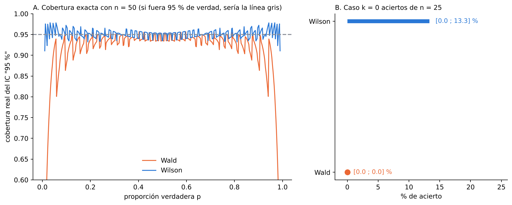

*Figura 13 (propia). **A:** cobertura exacta (calculada con la binomial) de los "IC 95 %" con $n=50$. Wald cae muy por debajo de 95 % (mínimo ≈ 39 % cerca de los extremos); Wilson se mantiene mucho más cerca (mínimo ≈ 91 %). **B:** con 0 aciertos de 25, Wald da [0; 0] (certeza absurda) y Wilson [0; 13,3] %.*

**Ejemplo con tus datos.** Respuesta que cambia al borrar una figura objetivo: $k=51$, $n=120$, $\hat p=42{,}5\,\%$.
- Wilson: **[34,0 ; 51,4] %** (el de la memoria).
- Wald: [33,7 ; 51,3] % (parecido, porque $\hat p$ está lejos de los extremos y $n$ es grande).

**Cuando importa de verdad:** acierto 0 % con $n=25$ (varios casos de tu memoria): Wald diría [0; 0]; Wilson dice [0; 13,3] %, es decir, "un acierto real de hasta 13 % es compatible con no haber visto ninguno".

**Regla de decisión (§2.7.5).** Un modelo supera una línea base fija (azar, clase mayoritaria) **solo si el límite inferior de su intervalo de Wilson queda por encima de ella**. Equivale aproximadamente a una prueba binomial unilateral con $\alpha=0{,}025$.

**Por qué Wilson y no otro.** Brown, Cai & DasGupta (2001) comparan varios intervalos para la proporción y muestran que Wald es el peor en cobertura y que Wilson es una buena opción por defecto. Alternativa "exacta": Clopper-Pearson (más conservador, tiende a ser más ancho de lo necesario).

📚 Wilson (1927), *J. Am. Stat. Assoc.* 22(158) · Brown, Cai & DasGupta (2001), *Statistical Science* 16(2) (este es el que hay que leer).

### 8.2 McNemar exacto y prueba de signos (Ec. 2.14)

**Pregunta.** Tengo dos condiciones medidas sobre **las mismas preguntas** (borrar objetivo vs borrar control; dos modelos sobre el mismo benchmark). ¿Difieren de verdad?

**Por qué no comparar los dos intervalos.** Las dos mediciones **no son independientes**: son las mismas preguntas. Comparar dos IC como si vinieran de muestras distintas ignora que las preguntas "fáciles" son fáciles en ambas, y desperdicia la información del pareo.

**Idea.** Clasifica cada pregunta en una tabla 2×2. **Solo importan las preguntas donde las dos condiciones discrepan**; en las que coinciden no hay información sobre cuál es mejor.

| | Control cambia | Control no cambia |
|---|---|---|
| **Borrar objetivo cambia** | 8 | **$n_{10}=43$** |
| **Borrar objetivo no cambia** | **$n_{01}=5$** | 64 |

Si ambas condiciones tuvieran el mismo efecto, cada discrepancia caería de un lado o del otro con probabilidad ½. O sea, $n_{10}\sim\mathrm{Binomial}(n_{10}+n_{01},\tfrac12)$. El valor $p$ bilateral exacto:

$$p=\min\Big(1,\ 2\sum_{j=0}^{\min(n_{10},n_{01})}\binom{n_{10}+n_{01}}{j}\Big(\tfrac12\Big)^{n_{10}+n_{01}}\Big)$$

Con $n_{10}=43$, $n_{01}=5$: $p\approx1{,}4\cdot10^{-8}$.

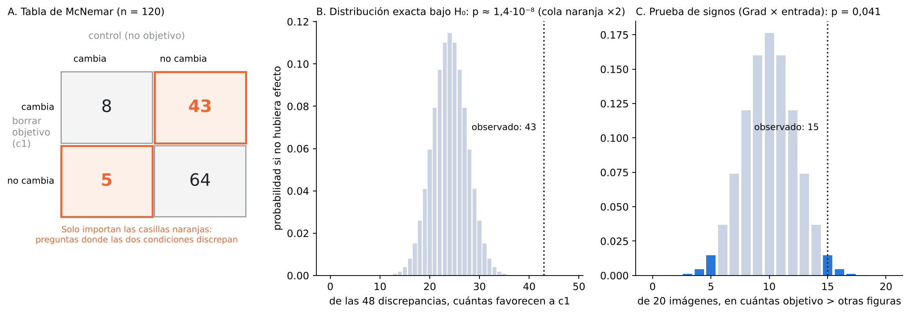

*Figura 14 (propia, datos reales). **A:** tabla de McNemar de tu oclusión. **B:** si no hubiera efecto, de las 48 discrepancias esperarías ~24 de cada lado; observar 43 vs 5 está muy en la cola. **C:** la prueba de signos de Grad×entrada (15 de 20): cola mucho más gruesa (p = 0,041).*

- **Versión aproximada.** $\chi^2=(n_{10}-n_{01})^2/(n_{10}+n_{01})=38^2/48=30{,}1$ (1 g.l.), $p\approx4\cdot10^{-8}$. La memoria usa la versión **exacta** (binomial), que es la apropiada cuando hay pocas discrepancias.
- **Prueba de signos.** Es la **misma fórmula** aplicada a pares de valores continuos: cuenta en cuántos pares el primero supera al segundo. En tu Grad×entrada: la contribución de las figuras objetivo supera a la de las otras en 15 de 20 imágenes → $p=2\,P(X\ge15)=0{,}041$ con $X\sim\mathrm{Bin}(20,\tfrac12)$.
- **Wilcoxon de rangos con signo (1945).** Para pares, pero además **usa el tamaño** de las diferencias (no solo su signo). En tu caso da $p=0{,}070$. Más información, pero supone simetría. Que el signo dé 0,041 y Wilcoxon 0,070 es la razón de que la memoria diga "significancia **marginal**".
- **Mann-Whitney (1947).** Para **dos grupos independientes** (sin pareo). Lo usas para el percentil de la figura borrada en Grad-CAM entre las 12 preguntas cuya respuesta cambió y las 8 en que no ($p=0{,}29$: no concluyente).

**Cómo se elige.** ¿Pareado y binario (sí/no)? → McNemar. ¿Pareado y continuo? → signos o Wilcoxon. ¿Grupos distintos y continuo? → Mann-Whitney.

📚 McNemar (1947), *Psychometrika* 12(2) · Wilcoxon (1945), *Biometrics Bulletin* 1(6) · Mann & Whitney (1947), *Ann. Math. Stat.* 18(1).

### 8.3 Regresión lineal y pendiente (Ec. 2.15, 2.16)

**Pregunta.** ¿Cuánto sube la respuesta del modelo por cada figura real de más? ¿Es 1 (cuenta), 0 (ignora la imagen) o algo intermedio?

**Modelo.** $\hat y_i=\beta_0+\beta_1 y_i+\varepsilon_i$, ajustado por **mínimos cuadrados ordinarios** (la recta que minimiza la suma de errores al cuadrado):

$$\hat\beta_1=\frac{\sum_i (y_i-\bar y)(\hat y_i-\bar{\hat y})}{\sum_i (y_i-\bar y)^2},\qquad \widehat{EE}(\hat\beta_1)=\sqrt{\frac{\sum_i\hat\varepsilon_i^2/(n-2)}{\sum_i(y_i-\bar y)^2}}$$

Intervalo de 95 %: $\hat\beta_1\pm t_{0{,}975;\,n-2}\,\widehat{EE}(\hat\beta_1)$.

**Cómo se lee.**
- Un modelo que **cuenta sin error**: $\beta_0=0,\ \beta_1=1$.
- Un modelo que **ignora la imagen**: $\beta_1=0$.
- **Tu resultado:** $\hat\beta_1=0{,}445$ [0,368; 0,523], $\hat\beta_0=0{,}92$ [0,43; 1,42], $R^2=0{,}52$. El intervalo de $\beta_1$ **no contiene 1** (no cuenta) **ni 0** (sí reacciona).

**$R^2$** es la fracción de la variación de la respuesta que explica la recta: 52 %. Un ajuste contra $\log y$ da 50 %, es decir, **no mejora**, por eso la memoria describe la escala como "lineal comprimida" y no logarítmica.

**Supuestos y por qué hay que mirarlos.** El intervalo $t$ supone errores aproximadamente normales y de varianza constante. Tu variable respuesta toma **solo 5 valores** (1, 2, 3, 4, 6): los errores no son normales. Con $n=120$ el intervalo suele seguir siendo razonable (efecto de muchos datos), y de hecho el bootstrap, que no supone normalidad, da prácticamente lo mismo:

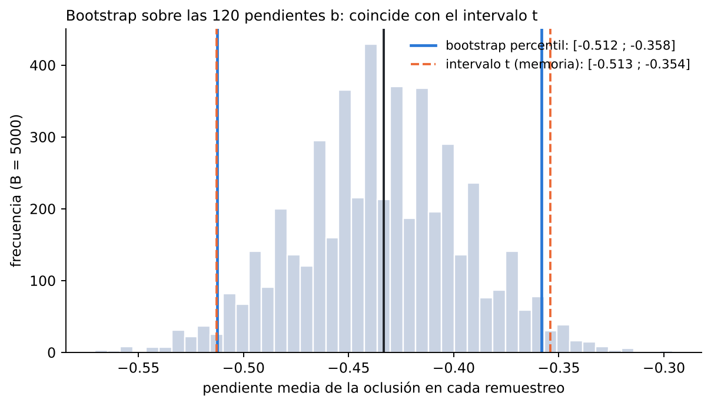

*Figura 15 (propia). Bootstrap (B = 5000, semilla 2026) de la pendiente media de la oclusión sobre tus 120 valores de $b$: [−0,5125 ; −0,3583] frente al intervalo $t$ de la memoria [−0,5127 ; −0,3539]. Son prácticamente idénticos: el supuesto de normalidad no es un problema serio aquí.*

**Regla de decisión (§2.7.5).** Para contrastar una pendiente con un valor de referencia (1 si cuenta, 0 si no reacciona), **se rechaza el valor si queda fuera del intervalo de 95 %**.

**Comparar pendientes con intervalos que se traslapan.** En la oclusión, $-0{,}433$ [−0,513; −0,354] y $-\hat\beta_1=-0{,}445$ [−0,523; −0,368] **se traslapan casi por completo**: eso es *consistente* con $H_E$. Ojo con la lógica: que se traslapen **no demuestra** que sean iguales; solo que los datos no los distinguen.

### 8.4 Bootstrap percentil (Ec. 2.17)

**Pregunta.** El sMAPE **no es una proporción**: es un promedio de errores relativos acotados y asimétricos. No hay fórmula cerrada simple para su incertidumbre. ¿Cómo se la mide?

🧒 *Tienes 100 papelitos, cada uno con el error de una pregunta. Para saber cuánto podría moverse el promedio si hubieras tenido otra muestra, haces como si tus 100 papelitos fueran **todo el mundo**: sacas 100 papelitos **con reemplazo** (puede salir el mismo varias veces), calculas el promedio, lo anotas, y repites muchas veces. Los promedios anotados te muestran cuánto se mueve.*

**Algoritmo (con $B=5000$):**

```python
import numpy as np
rng = np.random.default_rng(2026)                  # semilla fija -> intervalos reproducibles
terminos = ...                                      # un término de la Ec. 2.4 por pregunta (100 si es inválida, Ec. 2.5)
n = len(terminos)
stats = [rng.choice(terminos, size=n, replace=True).mean() for _ in range(5000)]   # B remuestreos
lo, hi = np.percentile(stats, [2.5, 97.5])          # percentiles 2,5 y 97,5 de los 5000 sMAPE
```

**Por qué funciona.** La muestra es la mejor estimación de la población; remuestrearla imita "tener otra muestra". No supone normalidad ni fórmulas: solo que las preguntas son independientes entre sí.

**Detalle de tu memoria.** Para el sMAPE₁₀₀ se remuestrean las $n$ preguntas, con un término de 100 por respuesta inválida (Ec. 2.5).

**Regla de decisión (§2.7.5).** Dos sMAPE se consideran distintos **solo si sus intervalos bootstrap no se traslapan**. Es **conservador**: dos intervalos que se traslapan levemente aún pueden corresponder a una diferencia significativa. (Lo correcto sería hacer el bootstrap **de la diferencia** pareada; la memoria prefiere la regla simple y lo declara.)

📚 Efron & Tibshirani (1993), *An Introduction to the Bootstrap* (caps. 6 y 13 para el percentil).

### 8.5 Comparaciones múltiples y análisis posterior (honestidad metodológica)

Dos puntos que la memoria **ya declara** y que conviene tener claros:

1. **No se corrige por comparaciones múltiples.** Las tablas del Cap. 4 tienen varias decenas de comparaciones. Con $\alpha=0{,}05$ cabe esperar alguna diferencia "significativa" por azar. Los resultados con $p$ cerca de 0,05 se reportan como **indicativos**. Corrección típica: **Holm** (controla la tasa de error global y es menos conservadora que Bonferroni).
   - Tus resultados fuertes (oclusión $p\approx10^{-8}$, grounding $p=0{,}002$) sobreviven a cualquier corrección razonable.
   - Los marginales (Grad×entrada $p=0{,}041$ / $0{,}070$) **no** la sobrevivirían.
2. **$H_C$ vs $H_E$ se formuló después de ver los datos** (memoria §3.4). Es un análisis *posterior* (*post hoc*): cuando una hipótesis se formula mirando los datos, el $p$ no tiene el mismo significado que el de una hipótesis fijada antes. Por eso la memoria lo declara como tal.

### 8.6 Resumen: qué herramienta para qué pregunta

| Quiero… | Uso | Evito | Por qué |
|---|---|---|---|
| El rango de un **% de acierto** | Wilson | Wald | Wald cubre mal con $n$ chico o $\hat p$ extremo, y da [0;0] con 0 aciertos |
| Saber si **supera** al azar / clase mayoritaria | Límite inferior de Wilson > línea base | Mirar solo el punto | El punto ignora la incertidumbre |
| Comparar **dos condiciones sobre las mismas preguntas** (binario) | McNemar exacto | Comparar dos IC | Las mediciones son pareadas, no independientes |
| Comparar **pares continuos** | Signos / Wilcoxon | t pareada con datos raros | No supone normalidad |
| Comparar **dos grupos independientes** (continuo) | Mann-Whitney | McNemar | No hay pareo |
| La **pendiente** de una relación | MCO + IC $t$ (y bootstrap como chequeo) | Solo el $R^2$ | El $R^2$ no dice cuánto cambia $y$ por unidad de $x$ |
| El rango de un **sMAPE** | Bootstrap percentil | Wilson / fórmula normal | El sMAPE no es una proporción; está acotado y es asimétrico |

---

## 9. Cómo se juntan las cuatro

### 9.1 La tabla de lectura (memoria §3.4, adaptada)

Cada técnica responde una pregunta distinta. Cruzando **localiza** (grounding) con **depende causalmente** (oclusión):

| ¿Localiza? (grounding) | ¿La respuesta depende de esas figuras? (oclusión) | Lectura |
|---|---|---|
| sí | sí | Cuenta, al menos en el rango probado |
| sí | no | Ve, pero falla al agregar el conteo |
| no | sí | Usa una señal parcial o difusa |
| no | no | Heurística o *prior* (números redondos, anclaje) |

**Tu resultado:** localiza ≈ 70 % de las figuras **y** la respuesta reacciona específicamente a ellas (42,5 % vs 10,8 % del control), pero con pendiente −0,43 y repertorio de 5 valores. Es una combinación **intermedia**: ve, usa lo que ve, pero **estima en una escala comprimida** en lugar de contar. (Y los mapas internos no aportan a esa conclusión.)

### 9.2 La jerarquía de evidencia

De la más fuerte a la más débil, para la pregunta "¿qué usa el modelo para responder?":

1. **Oclusión (intervención).** Cambia la entrada y mide el efecto. Es la única que muestra **causalidad**.
2. **Grounding (conducta de otra habilidad).** Muestra que el modelo *puede* localizar, no que *use* esa localización para contar.
3. **Grad × entrada (atribución con signo).** Sensibilidad local de la respuesta, dependiente de la pregunta. Correlacional.
4. **Grad-CAM (atribución sin signo, promediada).** Más ruidosa y, en este caso, dominada por el fondo.
5. **Attention rollout (observación de atención).** La menos informativa para esta pregunta: ni siquiera depende de la pregunta.

Esto es exactamente lo que concluye la memoria en §4.7.5: *"las pruebas de conducta son las más informativas; los mapas internos aportan poco"*, con la advertencia de Jain & Wallace (2019).

### 9.3 Qué NO puede afirmar cada técnica (para no sobreinterpretar)

| Técnica | Puede decir | **No** puede decir |
|---|---|---|
| Oclusión | La respuesta depende (o no) de esa figura | *Cómo* la usa; que la pendiente refleja "estimación" y no un techo |
| Grounding | El modelo es capaz de localizar | Que `query()` use esa localización |
| Rollout | Qué tokens dominan el flujo en el encoder | Qué usa el modelo para responder; que lo que no brilla sea irrelevante |
| Grad-CAM | Hacia qué tokens es sensible el logit, localmente | Que esos tokens *causen* la respuesta; nada fino si el objeto es menor que un token |

### 9.4 Sobre generalizar

- **Un solo modelo** (moondream2), **conteos bajos** (2–10), **120 preguntas** y **20** para los mapas, **un tipo de imagen sintética**. Es un **estudio piloto** con controles, no una conclusión sobre todos los VLM pequeños.
- Trabajos recientes con modelos de ≥7B (según tu búsqueda del 9-nov) encuentran que el conteo "pasa" de los tokens de imagen al texto en capas intermedias y que hay **subitización** (preciso con pocos objetos, ruidoso con más). Tu hallazgo (repertorio de pocos valores y techo en 6) es cualitativamente compatible con estimar en vez de contar, pero **no** es evidencia del mismo mecanismo.
- **Trabajo futuro** natural, ya mencionado en la memoria: extender la oclusión a los otros 3 modelos (es la única técnica que no necesita acceso al interior); figuras más grandes; otras resoluciones. Como técnicas más fuertes que Grad-CAM/rollout: *activation patching* y *attention knockout* (intervenciones internas).

---

## 10. Preguntas que te pueden hacer

**1. ¿Por qué cuatro técnicas y no una?**
Porque cada una responde una pregunta distinta (ve / usa / procesa / influye) y ninguna es suficiente sola. Las de conducta tratan al modelo como caja negra y son causales (oclusión) o de capacidad (grounding); las internas muestran cómo procesa, pero son correlacionales. Cruzadas se contrastan entre sí.

**2. ¿Qué es un token de imagen en moondream2 y cuántos hay?**
Una ficha de 2048 números que representa una región de ~38×38 px de la imagen original. Siempre son 729 (27×27), fusionando la vista global (378 px) con los recortes locales.

**3. ¿Por qué el rollout es igual para cualquier pregunta?**
Porque se calcula sobre el encoder visual, que no recibe la pregunta: el texto entra recién al LLM (máscara de atención: la imagen no ve a la pregunta).

**4. ¿Qué es un *attention sink* y por qué aparece?**
Un token (típicamente de norma muy alta y en una región de baja información) al que muchas posiciones atienden siempre. Darcet et al. (2024) lo explican como memoria global que el modelo reutiliza. En tus datos son 8 tokens fijos (1,1 %) con 19,4 % de la masa, idénticos con una imagen gris o de ruido.

**5. ¿Por qué se suma la identidad en el rollout?**
Por las conexiones residuales: cada token conserva su propia información además de la que recoge por atención. Sin la identidad se perdería ese camino directo.

**6. ¿Por qué Grad-CAM usa ReLU?**
Para conservar solo la evidencia **a favor** de la clase elegida y descartar la que va en contra. La versión con signo (gradiente × entrada) conserva ambas.

**7. ¿Por qué el logit y no la probabilidad?**
El softmax satura: si el modelo ya está seguro, el gradiente de la probabilidad es casi cero aunque la imagen importe. El logit no satura.

**8. ¿Por qué Grad-CAM queda en el fondo y gradiente×entrada no tanto?**
Grad-CAM promedia el gradiente sobre los 729 tokens para obtener un peso por canal; el 97 % de esos tokens es fondo, así que el peso es el del fondo. Gradiente×entrada usa el gradiente de cada token. (Deducción en §7: Grad-CAM conserva solo el término "gradiente medio × entrada media" y descarta la covarianza.)

**9. Enriquecimiento ≈ 1,02 en el fondo, ¿no significa que no distingue el fondo?**
Con el fondo ocupando 97,4 % del área, la cota máxima es 1,03: un 1,02 significa que casi toda la masa del mapa está en el fondo, no que el mapa sea indiferente.

**10. ¿Por qué usaron McNemar y no comparar los IC de Wilson?**
Porque las condiciones se miden sobre las mismas preguntas: no son independientes. McNemar usa solo las discrepancias.

**11. ¿Por qué Wilson y no Wald?**
Wald cubre mal con $n$ chico o $\hat p$ cerca de 0 o 1, y da ancho cero con 0 aciertos. Wilson tiene mejor cobertura y se mantiene dentro de [0,1].

**12. ¿Qué evidencia hay de que "estima" y no solo "satura"?**
Las dos pendientes (respuesta vs correcta: 0,445, y oclusión: −0,433) coinciden, como predice $H_E$. Pero el modelo solo emite {1, 2, 3, 4, 6} y la formulación fue posterior; un efecto techo también es compatible. Es la limitación que conviene reconocer antes de que te la señalen.

**13. ¿Por qué la oclusión redibuja en vez de tapar con gris?**
Para no introducir un objeto nuevo (el cuadro gris) que el modelo podría contar o que cambiaría la imagen de otra forma.

**14. ¿Por qué temperatura 0?**
Con el muestreo por defecto (T = 0,5), una diferencia entre c0 y c1 podría ser ruido. Con T = 0 la respuesta es determinista (verificado en 10 de 10 repeticiones).

**15. ¿`point()` demuestra que el modelo cuenta?**
No. Es una habilidad distinta de `query()`. Muestra que puede localizar; el vínculo causal con la respuesta lo da la oclusión.

**16. ¿Por qué solo 20 de las 120 preguntas para los mapas?**
Costo de cómputo y revisión; se sortearon con semilla dentro de grupos por error (7 aciertos, 7 cercanos, 6 lejanos). Es una limitación: el resultado marginal de gradiente×entrada se apoya en n = 20.

---

## 11. Mapa de papers y ruta de lectura

### Ruta sugerida (de lo imprescindible a lo opcional)

**Nivel 1: imprescindibles para defender el experimento (≈ 1 semana de lectura tranquila)**
1. Selvaraju et al. (2017), Grad-CAM. Lee la §3 completa.
2. Abnar & Zuidema (2020), Attention Rollout. Lee la §2.
3. Zeiler & Fergus (2014), la parte de *occlusion sensitivity*.
4. Darcet et al. (2024), Registers. Lee la introducción y la §2 (el fenómeno de los artefactos de alta norma).
5. Jain & Wallace (2019), Attention is not Explanation.
6. Brown, Cai & DasGupta (2001), intervalos para proporciones.

**Nivel 2: para entender mejor las bases**
7. Vaswani et al. (2017), Transformers. 8. Dosovitskiy et al. (2021), ViT. 9. Zhai et al. (2023), SigLIP. 10. Shrikumar et al. (2017), DeepLIFT / grad×entrada. 11. Efron & Tibshirani (1993), bootstrap.

**Nivel 3: para el trabajo futuro y para ir más allá**
12. Sundararajan et al. (2017), Integrated Gradients. 13. Chefer et al. (2021), rollout mejorado. 14. Wiegreffe & Pinter (2019). 15. Adebayo et al. (2018), controles. 16. Fong & Vedaldi (2017); Petsiuk et al. (2018) (oclusión generalizada). 17. Deitke et al. (2024), Molmo (señalar para contar). 18. Trabajos recientes de conteo en VLMs de tu búsqueda del 9-nov (Sengupta et al.; *Counting Circuits*; CountScope; Kaduri et al.), todos ≥ 7B.

### Tabla de referencia

| Paper | Año / lugar | arXiv | Se usa en | Está en tu memoria |
|---|---|---|---|---|
| Vaswani et al., *Attention Is All You Need* | 2017 NeurIPS | 1706.03762 | Atención (Ec. 2.18) | No |
| Dosovitskiy et al., *An Image is Worth 16x16 Words* (ViT) | 2021 ICLR | 2010.11929 | Encoder visual | No |
| Zhai et al., *Sigmoid Loss for Language Image Pre-Training* (SigLIP) | 2023 ICCV | 2303.15343 | Encoder visual de moondream2 | No |
| Zeiler & Fergus, *Visualizing and Understanding Convolutional Networks* | 2014 ECCV | 1311.2901 | Oclusión | **Sí** |
| Selvaraju et al., *Grad-CAM* | 2017 ICCV | 1610.02391 | Grad-CAM | **Sí** |
| Shrikumar et al., *Learning Important Features Through Propagating Activation Differences* | 2017 ICML | 1704.02685 | Grad × entrada | **Sí** |
| Abnar & Zuidema, *Quantifying Attention Flow in Transformers* | 2020 ACL | 2005.00928 | Rollout | **Sí** |
| Darcet et al., *Vision Transformers Need Registers* | 2024 ICLR | 2309.16588 | Attention sinks | **Sí** |
| Jain & Wallace, *Attention is not Explanation* | 2019 NAACL | 1902.10186 | Límites de la atención | **Sí** |
| Wiegreffe & Pinter, *Attention is not not Explanation* | 2019 EMNLP | 1908.04626 | Réplica | No |
| Simonyan et al., *Deep Inside Convolutional Networks* | 2014 ICLR-W | 1312.6034 | Saliencia por gradiente | No |
| Sundararajan et al., *Axiomatic Attribution for Deep Networks* | 2017 ICML | 1703.01365 | Alternativa a grad×entrada | No |
| Smilkov et al., *SmoothGrad* | 2017 | 1706.03825 | Ruido de gradientes | No |
| Chefer et al., *Transformer Interpretability Beyond Attention Visualization* | 2021 CVPR | 2012.09838 | Mejora del rollout | No |
| Adebayo et al., *Sanity Checks for Saliency Maps* | 2018 NeurIPS | 1810.03292 | Controles | No |
| Xiao et al., *Efficient Streaming LMs with Attention Sinks* | 2023 | 2309.17453 | Sinks en LLMs | No |
| Fong & Vedaldi, *Meaningful Perturbation* | 2017 ICCV | 1704.03296 | Oclusión generalizada | No |
| Petsiuk et al., *RISE* | 2018 BMVC | 1806.07421 | Oclusión aleatoria | No |
| Deitke et al., *Molmo and PixMo* | 2024 | 2409.17146 | Señalar para contar | No |
| Wilson (1927) | JASA 22(158) | (no aplica) | IC de proporción | **Sí** |
| Brown, Cai & DasGupta (2001) | Stat. Sci. 16(2) | (no aplica) | Wilson vs Wald | **Sí** |
| McNemar (1947) | Psychometrika 12(2) | (no aplica) | Prueba pareada | **Sí** |
| Wilcoxon (1945); Mann & Whitney (1947) | Biometrics Bull. / Ann. Math. Stat. | (no aplica) | Pruebas de rangos | **Sí** |
| Efron & Tibshirani (1993) | libro | (no aplica) | Bootstrap | **Sí** |

> **Antes de citar un paper que no está en tu memoria**, ábrelo y verifica título, año y congreso: las referencias de esta tabla las escribí de memoria desde mi conocimiento (y confirmé por búsqueda que Abnar & Zuidema y Molmo existen con esos números de arXiv), pero no abrí cada PDF. Los trabajos recientes de conteo vienen de tu búsqueda del 9-nov y no los verifiqué de nuevo.

---

## 12. Glosario

| Término | Significado |
|---|---|
| **Token** | Unidad que procesa el modelo. En imagen, un parche; en texto, un pedazo de palabra. |
| **Embedding** | Vector de números que representa un token (2048 en el LLM de moondream2). |
| **Parche** | Cuadrado de 14×14 px de un recorte. |
| **Recorte global / local** | Imagen completa reducida a 378×378 / ventanas de 378×378 de la imagen agrandada a 910 px. |
| **ViT** | Vision Transformer: encoder que procesa parches con atención. |
| **SigLIP** | ViT preentrenado con pérdida sigmoide sobre pares imagen-texto; es el encoder de moondream2. |
| **Atención** | Mecanismo donde cada token pondera a los demás. $\mathrm{softmax}(QK^\top/\sqrt d)V$. |
| **Cabeza (head)** | Copia independiente del mecanismo de atención dentro de una capa. |
| **Conexión residual** | Suma de la entrada de un bloque a su salida. |
| **Bidireccional / causal** | Todos ven a todos / cada token ve solo los anteriores. |
| **Logit** | Puntaje crudo (antes del softmax) de cada palabra posible. |
| **Argmax** | El índice del valor máximo; con T = 0 es el token elegido. |
| **Gradiente** | Cuánto cambia la salida si cambio una entrada un poquito ($\partial s/\partial E$). |
| **Backward / retropropagación** | Cálculo de todos los gradientes aplicando la regla de la cadena hacia atrás. |
| **Saliencia / mapa de calor** | Mapa que asigna a cada región un valor de "importancia". |
| **Atribución** | Asignar a cada parte de la entrada su contribución a la salida. |
| **Oclusión** | Borrar/tapar una parte de la entrada y medir el cambio de la salida. |
| **Contrafactual** | "Qué pasaría si la entrada fuera distinta": la base de la oclusión. |
| **Grounding** | Localizar en la imagen lo que se menciona en el texto. |
| **Rollout** | Producto de las matrices de atención (con identidad) a través de las capas. |
| **Attention sink** | Token que recibe atención de forma sistemática, típicamente de norma alta y poca información. |
| **Enriquecimiento** | Fracción del mapa en una región ÷ fracción del área que ocupa. |
| **Intervalo de confianza (IC) 95 %** | Rango que, repetido el muestreo muchas veces, contendría al valor verdadero en el 95 % de los casos. |
| **Cobertura** | Probabilidad real de que un IC contenga al valor verdadero. |
| **Wilson / Wald** | Dos intervalos para una proporción; Wilson tiene mejor cobertura. |
| **McNemar** | Prueba para dos condiciones binarias sobre los mismos casos. |
| **Prueba de signos / Wilcoxon** | Pruebas para pares continuos (solo signo / signo + tamaño). |
| **Mann-Whitney** | Prueba para dos grupos independientes. |
| **MCO** | Mínimos cuadrados ordinarios: la recta que minimiza el error cuadrático. |
| **Bootstrap** | Remuestreo con reemplazo para estimar la incertidumbre. |
| **sMAPE** | Error porcentual absoluto medio simétrico. |
| **Post hoc** | Hipótesis formulada después de ver los datos. |
| **$H_C$ / $H_E$** | Hipótesis "cuenta" ($\beta_1=1$) / "estima" ($0<\beta_1<1$). |
| **c0 / c1 / c2 / control** | Imagen original / sin 1 figura objetivo / sin 2 / sin 1 figura no objetivo. |

---

## Apéndice A: cómo reproducir las cifras

Verificación hecha: recalculé desde tus CSV (`resultados/01_conducta/analisis/por_pregunta.csv` y `resultados/03_gradcam/analisis/por_imagen.csv`) y **todas coinciden con la memoria v5**:

| Cifra | Memoria | Recalculada |
|---|---|---|
| Acierto en c0 | 12,5 % (15/120) | 15/120 ✔ |
| Repertorio de respuestas | 1, 2, 3, 4, 6 | {1: 2, 2: 37, 3: 33, 4: 20, 6: 28} ✔ |
| $\hat\beta_1$ / $\hat\beta_0$ / $R^2$ | 0,445 / 0,92 / 0,52 | 0,4453 / 0,9237 / 0,5238 ✔ |
| IC $t$ de $\hat\beta_1$ | [0,368; 0,523] | [0,3679; 0,5227] ✔ |
| Pendiente media de oclusión | −0,433 [−0,513; −0,354] | −0,4333 [−0,5127; −0,3539] ✔ |
| Cambia al borrar objetivo / control | 42,5 % / 10,8 % | 51/120 / 13/120 ✔ |
| Wilson 51/120 | [34,0; 51,4] | [34,02; 51,44] ✔ |
| McNemar | 43 vs 5, p ≈ 1,4·10⁻⁸ | 43, 5, 1,37·10⁻⁸ ✔ |
| Conteo por puntos vs respuesta escrita | 25 vs 7, p = 0,002 | 25, 7, 0,0021 ✔ |
| Precisión de grounding | 77,0 % de 790 | 608/790 = 76,96 % ✔ |
| Signos Grad×entrada | 15/20, p = 0,041 | 15/20, 0,0414 ✔ |
| Wilcoxon Grad×entrada | 0,070 | 0,0696 ✔ |
| Mann-Whitney percentil | p = 0,29 | 0,287 ✔ |
| Enriquecimiento Grad-CAM (medianas) | 0,08 / 0,23 / 1,02 | 0,0765 / 0,227 / 1,022 ✔ |
| Rollout: mismos top-5 (gris vs q002); correlación | sí; 0,997 | sí; 0,9972 ✔ |
| Caso q099: puntos sobre triángulos | 7 de 9 | 7 de 9 ✔ |

Código para reproducir lo principal (ajusta la ruta; solo necesita `pandas`, `numpy` y `scipy`):

```python
import math, numpy as np, pandas as pd
from scipy import stats

t = pd.read_csv("resultados/01_conducta/analisis/por_pregunta.csv")
G = t["gt"]                       # OJO: t.gt es un método de pandas (mayor que); usa t["gt"]

# 1) Regresión de la respuesta contra la correcta (Ec. 2.15-2.16)
r = stats.linregress(G, t.c0)
tc = stats.t.ppf(0.975, len(t) - 2)
print("beta1", r.slope, "IC", r.slope - tc*r.stderr, r.slope + tc*r.stderr)

# 2) Pendiente de la oclusión por pregunta (Ec. 3.7) y su IC t
b = (t.c2 - t.c0) / 2
se = b.std(ddof=1) / math.sqrt(len(b))
print("pendiente media", b.mean(), b.mean() - tc*se, b.mean() + tc*se)

# 3) Wilson (Ec. 2.13)
def wilson(k, n, z=1.96):
    p = k / n
    c = (p + z*z/(2*n)) / (1 + z*z/n)
    m = z * math.sqrt(p*(1-p)/n + z*z/(4*n*n)) / (1 + z*z/n)
    return c - m, c + m
print("Wilson 51/120", wilson(51, 120), " Wilson 0/25", wilson(0, 25))

# 4) McNemar exacto (Ec. 2.14): c1 cambia vs control cambia
ch1, chc = t.c1 != t.c0, t.control != t.c0
n10, n01 = (ch1 & ~chc).sum(), (~ch1 & chc).sum()
print("McNemar", n10, n01, stats.binomtest(min(n10, n01), n10 + n01, 0.5).pvalue)

# 5) Bootstrap percentil (Ec. 2.17) de la pendiente, semilla 2026
rng = np.random.default_rng(2026)
medias = [rng.choice(b, len(b), replace=True).mean() for _ in range(5000)]
print("bootstrap", np.percentile(medias, [2.5, 97.5]))
```

## Apéndice B: lista de figuras

**De la memoria (copiadas tal cual):** Fig. 9, Fig. 30, Fig. 31, Fig. 32, Fig. 33.
**Propias de esta guía (hechas con tus datos reales cuando se indica):** Fig. 1 (pipeline con formas de tensores), 2 (recortes, imagen real), 3 (máscara de atención), 4 (grilla de tokens, imagen real), 5 (condiciones de oclusión, caso q004 real), 6 (pendiente con tres puntos), 7 (H_C vs H_E, 120 preguntas reales), 8 (`point()` + caso q099 real), 9 (ejemplo didáctico de rollout), 10 (rollout y normas reales), 11 (flujo de Grad-CAM), 12 (cota del enriquecimiento), 13 (Wilson vs Wald), 14 (McNemar y signos, datos reales), 15 (bootstrap de la pendiente, datos reales).

*Nota sobre la numeración:* las figuras "propias" tienen numeración correlativa solo dentro de esta guía, y no coinciden con la de la memoria; las de la memoria se identifican como "Figura 9, 30, 31, 32, 33 (memoria)".

